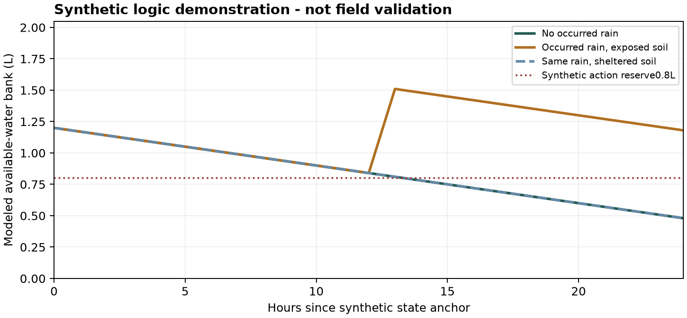

# WeedGrow - Algorithm blueprint & emulator

v7.3 | FACTOR RULES, PSEUDOCODE AND ALL WARNING CALLS | 30 OCTOBER 2026

This implementation-design revision turns the v7.2 evidence contract into named functions, factor rules, warning calls, state transitions and a runnable offline reference. It preserves simple setup, optional watering amount and no daily measurement burden.

The reference runs end to end on synthetic inputs. It is deliberately prevented from releasing a watering recommendation through an unvalidated profile. Candidate water decisions and forecast projections remain debug outputs; disease probabilities remain unassigned.

## Deliverables and verified scope

The package includes this blueprint, editable Markdown, standalone pseudocode, a42-factor/14-warning registry, executable emulator, synthetic input/output and 79 passing scenario tests plus1,000 seeded bank trials. These verify logic, not agronomic accuracy, disease detection or prevention.

The source studies and parameter restrictions remain in v7.2 and the carried-forward machine ledger. v7.3 adds executable behavior and identified implementation gaps. Application code, accounts, subscriptions and notification delivery were not changed.

Read sections01-04 for architecture/contracts; 05-08 for every factor; 09-14 for water calculations; 15-19 for warning calls/delivery; 20-22 for verification, limits and handoff. All synthetic capacities, loss coefficients and refill amounts are test values, not proposed cannabis calibration.

<!-- page break -->

# 01  End-to-end algorithm

EACH PATH FAILS INDEPENDENTLY; A WATER GAP DOES NOT HIDE A SOURCE HAZARD

```
evaluatePlant(input):
  authorizePlantRead(input.user, input.plant)
  if inactiveOrDeleting(plant): return noActiveCare()
  facts = normalizeSimpleSetupAndDatedOptionalFacts(plant)
  weather = canonicalizeTypedWeather(rawWeather, facts.location)
  logs = canonicalizeWaterEvents(rawLogs)
  profile = resolveSupportedProfile(facts, modelRegistry)

  current = replayOccurredWaterBalance(profile, weather, logs)
  decision = releaseGate(robustDecision(current), profile)
  projection = projectConditionalForecast(current, weather)
  // projection NEVER replaces current stored water/decision

  ambient = pairedAirFeatures(weather, history, forecast)
  flags = evaluateAll14WarningsIndependently(
    facts, weather, sourceAlerts, decision, ambient, problemReport)
  cards = mergeSharedContextAndSourceEpisodes(flags)
  delivery = applyNotificationPolicy(cards, priorDeliveryState)
  return { needsWater: toNullableBoolean(decision),
           decision, flags, cards, reasons, coverage,
           profileVersion, computedAt, reevaluateAt }
```

Backend/application adapters authorize access, fetch data, normalize raw provider semantics and persist state. The offline reference starts after those adapters with explicit UTC intervals. Its evaluate function dispatches all14 warning IDs exactly once, even when a model is disabled or data is missing.

The production release registry in the emulator is empty. Adding approved:true to a JSON profile cannot enable it. An actual release requires validation, an approved version and application integration; ordinary users do not supply model coefficients or research measurements.

<!-- page break -->

# 02  Three kinds of output

A MEASUREMENT FACT, A CARE DECISION AND A WARNING ARE DIFFERENT OBJECTS

| Layer | Examples | Required semantics |
| --- | --- | --- |
| Input/feature fact | Paired air VPD; rain amount; source alert; covered hours. | A scoped estimate with interval, source, units and missingness. No hidden disease interpretation. |
| Water decision | water / not_due / uncertain. | needsWater:true /false /null. Unknown must survive every app consumer and persistence layer. |
| Warning result | W01 heat, W06 water, W11 flower weather. | Explicit state, reasons, evidence, phase and release/delivery eligibility. No automatic probability. |
| Card / notification | Merged heat/container card or wet-weather preparation. | Presentation and delivery rules; they do not change modeled moisture, disease state or source severity. |

```
FlagResult = {
  id: W01..W14, code: stableSemanticName,
  state: triggered | not_triggered | unknown |
         not_applicable | disabled | context_only | review_requested,
  reasons: ReasonCode[], evidence: ScopedEvidence,
  probability: null, pushEligible: falseUntilSupported
}
```

not_triggered means the stated screen was not met in a supported, declared window. It never means no disease or no weather harm. disabled means the model/route is intentionally unavailable; unknown means the necessary state/data cannot determine the answer. context_only reports conditions without claiming detection.

<!-- page break -->

# 03  Normalized input and real app mapping

RAW RECORDS MUST BE ADAPTED BEFORE THEY ENTER THE REFERENCE

| Existing/proposed record | Normalized emulator field | Rule |
| --- | --- | --- |
| Plant.environment / plantedIn | environment / planted_in | Outdoor scope; explicit pot/ground. |
| potSize / mediumChoice / sunlightExposure | pot_l / medium / sun | Parse labelled units; known category mapping; not sure -> unknown. No unitless litre default. |
| growthStage / ageKnown / ageRecordedAt | stage / age_known / age_asof | Retain seed-versus-clone meaning and dates. Do not substitute app creation time. |
| height or dated height log | height_cm / height_asof | Use actual dated measurement if available; no inferred daily growth. |
| Proposed rain reception answer | soil_rain / canopy_rain | yes/no/partial/unknown independently. One beginner-friendly setup choice can populate both. |
| PlantLog timestamp/precision/waterMl | earliest / latest / amount_l | mL toL explicitly; date-only UTC bounds from local calendar; zero is not omitted. |
| Raw weather products | start/end/kind/source/issued_at | Interval amount versus point/rate, correct UTC/location revision, per-variable nulls. |
| Profile registry / state estimate | profile + anchor + coherent scenarios | Backend quantities with provenance. Not extra client setup fields. |

Current app weather summaries are not enough to reconstruct hourly histories. Preserve raw paired intervals, actual occurred-estimate provenance and per-variable coverage. The existing boolean needsWater interface and same-day override require an eventual consumer migration; no migration is delivered here.

<!-- page break -->

# 04  Canonical events and time

FIX DUPLICATES, REVISIONS AND AMBIGUOUS TIME BEFORE WATER ACCOUNTING

```
canonicalWaterEvent(event):
  key = stable eventId or retry-safe mutation identity
  keep latest authoritative revision
  if deleted: remove its contribution and replay
  if conflicting same revision: water path UNKNOWN
  if exact occurrence: earliest = latest = occurrenceUTC
  if date-only:
    [earliest, dayEnd] = calendarBounds(day, IANAzone)
    latest = min(dayEnd, recordedAt, evaluationTime)
  reject negative amount or future/impossible occurrence
  // Two genuine equal-looking events stay separate.
```

Do not assume a local date lasts24hours. Timezone/DST conversion belongs to the real calendar adapter; the emulator accepts precomputed bounds and does not claim to test raw calendar parsing. A date-only event straddling the state anchor needs reconciliation, rather than half-counting or silently discarding it.

```
canonicalWeather(rows):
  keep latest issue for exact source/interval/nature key
  preserve occurred_estimate versus forecast versus point
  reject location mismatch and future values marked occurred
  invalid field -> null + quality reason (not field value0)
  overlapping/conflicting integrals -> unsupported replay
  // Point temperature can show a crossing, not wet-hours.
```

A historical forecast remains a forecast estimate. Current rain rate is not a daily amount; hourly interval mean rain intensity is not the peak minute rate. Distinct sources/models must not be summed as independent rainfall. A production adapter needs an explicit source-selection/reconciliation policy. [S12](https://openweathermap.org/api/one-call-3)

<!-- page break -->

# 05  Factor rules: Setup, age, size and baseline

ALL FACTORS HAVE A RULE; NOT EVERY FIELD DESERVES A NUMERIC WEIGHT

| Factor | Algorithmic effect | Affected path |
| --- | --- | --- |
| F01 Location / timezone | Select weather scope and local-day conversion. Location revision mismatch rejects old forcing/state; IANA day bounds may be23/25h. | all |
| F02 Outdoor / greenhouse / indoor | Outdoor weather can prepare for external hazards. It cannot supply internal humidity or the indoor watering model. | W01-W06; health scope |
| F03 Plant lifecycle | Archived, harvested, dead or deleting: no active care cards or notifications. | all |
| F04 Pot versus ground | Match separate supported model domains. Never convert pot litres into a ground root-zone profile. | W06; W08/action context |
| F05 Pot size and units | Explicit litres or explicit converted units. Match profile/storage ranges; no unitless litre assumption or catchment from volume. | W06 |
| F06 Medium family | Select supported retention, delivery and loss profiles. Unknown needs a separately validated aggregate profile. | W06 |
| F07 Soil provenance / layout | Native, raised or store-bought alone does not establish texture, FC or PWP. No hydraulic coefficient from this label. | no direct numeric effect |
| F08 Reported growth stage | Match growth profile; flowering gates W11; establishment contextualizes optional review. Stage changes need dated transition handling. | W06/W10/W11/W13 |
| F09 Dated age and origin | Compute effective age only when known/datable; seed and clone origins must match the profile. No exact roots or flowering from age. | W06 profile selection |
| F10 Dated height | Use only within profile freshness/domain; otherwise explicit aggregate fallback. It is not measured leaf area or plant consumption. | W06 profile selection |
| F11 Sun category | Select validated exposure profile. Full/partial/shade is not a measured radiation fraction or a fixed extra drying bonus. | W06; action wording |

Exact function ownership and stable factor IDs are in WeedGrow_Factor_Flag_Registry_v7.3.json. A validated aggregate fallback is preferable to inventing optional facts or repeatedly prompting the grower. The input contract still requires no daily moisture, height, temperature or canopy observations.

<!-- page break -->

# 06  Factor rules: Water inputs and atmospheric demand

ALL FACTORS HAVE A RULE; NOT EVERY FIELD DESERVES A NUMERIC WEIGHT

| Factor | Algorithmic effect | Affected path |
| --- | --- | --- |
| F12 Soil rain reception | No: zero direct rain. Yes: supported catchment/delivery. Unknown: bracket zero/full; partial: supported bounds. | W06 |
| F13 Canopy rain reception | Direct rain forecast adds wet-canopy/flower preparation only if reachable. Shelter does not remove ambient humidity. | W11/W12 |
| F14 Watering occurrence time | Replay in occurrence order, including known events at evaluation time; never use edit time as the watering time. | W06 |
| F15 Watering amount | Known amount times supported delivery/retention; omitted amount uses supported scenario ranges or abstains. Zero stays zero. | W06 |
| F16 Log time precision | Date-only event becomes earliest/latest UTC bounds capped by recorded time; branch timing, rather than invent noon. | W06 |
| F17 Edits / retries / deletions | Canonical event identity/version; duplicate retry adds no water, separate real events both count, deletion removes prior input. | W06 |
| F18 Repot / move / medium or stage change | Do not reuse a pre-change anchor. Carry or rebuild state only through a supported transition; prototype abstains. | W06; location-scoped flags |
| F19 Air temperature | Heat/cold screen and paired-air features. ET0 already contains its weather contribution; no second heat multiplier. | W01/W02; W09-W12 context |
| F20 Air relative humidity | Pair with same-interval temperature for air VPD/context. No high-RH necessary PM gate, soil-moisture estimate or leaf VPD. | W09-W12; W06 through ET0 |
| F21 Reference ET0 | Use correct interval sum; multiply by fitted effective coefficients with explicit units. Missing history ET0 blocks this water route. | W06 |

Exact function ownership and stable factor IDs are in WeedGrow_Factor_Flag_Registry_v7.3.json. A validated aggregate fallback is preferable to inventing optional facts or repeatedly prompting the grower. The input contract still requires no daily moisture, height, temperature or canopy observations.

<!-- page break -->

# 07  Factor rules: Weather factors and data quality

ALL FACTORS HAVE A RULE; NOT EVERY FIELD DESERVES A NUMERIC WEIGHT

| Factor | Algorithmic effect | Affected path |
| --- | --- | --- |
| F22 Solar radiation / cloud | Backend ET0 forcing or validated exposure profile. No UV-to-PAR replacement, extra cloud bonus or duplicate evaporation term. | W06 indirectly |
| F23 Mean wind | Mechanical weather screen; ET0 already accounts for wind in its own forcing model. Not canopy ventilation measurement. | W03; W06 indirectly |
| F24 Wind gust | Separate mechanical exposure signal; preserve m/s and source definition. Not an extra water-loss multiplier. | W03 |
| F25 Rain rate | Integrate only over its known interval for water amount; mean hourly rate cannot reveal peak minute intensity. | W04; W06 via amount |
| F26 Rain amount / liquid phase | Non-overlapping liquid-rain amount enters retained-water model. Snow/frozen precipitation needs a separate melt pathway. | W04/W06/W11/W12 |
| F27 Rain probability | Planning uncertainty only. Do not multiply rain amount by probability without provider semantics; never pre-credit current storage. | forecast planning |
| F28 Dew point | Optional paired ambient derivation/context with provenance; not leaf condensation or measured wetness. Prototype uses paired T/RH. | W09 context |
| F29 Daylight / solar night | Use local solar intervals for context. ET0/energy already reflects duration; no independent daylight water bonus. | W09; W06 indirectly |
| F30 UV index | May inform a separately scoped exposure message; not energy, water use, PAR or an automatic cannabis injury probability. | no extra water score |
| F31 Data age / gaps / overlap | Per-path variable coverage. Missing data is unknown, not zero. Positive supported hazard evidence may survive other gaps. | all |
| F32 Source hazard products | Typed verified mapping, location/validity and latest update/cancellation. No source coverage is not an all-clear. | W01-W05 |

Exact function ownership and stable factor IDs are in WeedGrow_Factor_Flag_Registry_v7.3.json. A validated aggregate fallback is preferable to inventing optional facts or repeatedly prompting the grower. The input contract still requires no daily moisture, height, temperature or canopy observations.

<!-- page break -->

# 08  Factor rules: Model scope and legitimate no-effect factors

ALL FACTORS HAVE A RULE; NOT EVERY FIELD DESERVES A NUMERIC WEIGHT

| Factor | Algorithmic effect | Affected path |
| --- | --- | --- |
| F33 Profile validation / version | Scope, state range, climate/source domain and approved release registry are prerequisites. No production profiles are bundled. | W06; future disease models |
| F34 Optional problem report | Route only the requested topic. A root/wilt review is not disease detection or an automatic instruction to water. | W07/W13/W14 |
| F35 No-symptoms observation | A dated optional observation; not proof of no latent infection and not a daily requirement. | no automatic disease clearing |
| F36 Optional observations / lab inputs | Moisture/pH/photos require a separate validated observation/problem path; no blind bank reset or nutrient diagnosis. Leaf/root temperatures, PAR and lab physiology remain excluded. | no required base dependency |
| F37 Cultivar / strain name | Display/research metadata; not a verified stomatal response or disease-resistance assay. | no resistance multiplier |
| F38 API soil grids | Regional soil temperature/moisture is not the water state of this pot or local rooting zone. | no measured moisture claim |
| F39 UI waterLevel / sensorProfileId | A UI gauge is not measured water; a profile ID is not proof of working sensors. | no moisture reset |
| F40 Missing watering logs | Absence of a log is not proof no water was applied. Validate real log adherence and uncertainty; do not learn dryness from compliance. | W06 validity |
| F41 Scheduler / cache / delivery state | Invalidate on all real dependencies; reevaluate automatically. Cooldown is a delivery rule, never a biological reset. | all |
| F42 Forecast versus occurred nature | Separate present replay and conditional projection. Past forecasts remain forecast estimates, not observed rain/history. | all |

Exact function ownership and stable factor IDs are in WeedGrow_Factor_Flag_Registry_v7.3.json. A validated aggregate fallback is preferable to inventing optional facts or repeatedly prompting the grower. The input contract still requires no daily moisture, height, temperature or canopy observations.

<!-- page break -->

# 09  Selecting a baseline profile

FITTED BACKEND PROFILES REPLACE UNIVERSAL DAYS-BETWEEN-WATERING MODIFIERS

```
resolveSupportedProfile(facts, registry):
  reject unsupported environment or inactive plant
  require pot/ground + stage + medium + sun scope match
  if profile uses pot size: require explicit valid litres
  if profile uses age:
    require known age, meaning and valid recorded date
    ageNow = recordedAge + elapsedDays(recordedDate, now)
    require supported seed/clone origin and age range
  if profile uses height:
    require dated height within tested freshness/range
  if optional fact unusable:
    follow explicitly supported aggregate fallback only
  require correct location, forcing source and state anchor
  return coherent parameter/state scenarios
  // no leaf area, root depth or moisture from height/age
```

A profile contains supported ranges for effective storage, initial reserve, action threshold, effective loss, rain catchment/delivery and unknown refill. These are coherent scenarios, not independent worst-case numbers chosen at random. Origin, training/validation domain, source products and profile version travel with them.

Effective loss coefficients have area units because ET0(mm)*m2 gives litres. They are fitted aggregate coefficients, not measured leaf area or automatically equal to pot opening. The prototype uses a constant coefficient over its short replay window; a real model must validate its climate/growth/soil-water operating range. [S33](https://open-meteo.com/en/docs)

If age or height is unavailable/stale, the resolver follows only an explicit supported fallback. A seven-day height freshness rule used by a test is a synthetic test condition, not a recommendation to measure weekly or a calibrated universal cutoff.

<!-- page break -->

# 10  Water balance and ordering

SIMPLE, AUDITABLE ACCOUNTING AROUND THE WATERING ACTION THRESHOLD

```
replayOccurredWaterBalance(profile, weather, logs):
  require valid anchor before evaluation time
  require complete ET0 history for selected source
  require complete rain history unless soil receives no rain
  reject unresolved duplicate/version conflicts
  reject an unhandled repot/move/medium/stage transition

  for scenario in supportedCorrelatedScenarios:
    for eventTiming in [earliest, latest]:
      for withinBinOrder in [inputsFirst, lossFirst]:
        R = scenario.initialReserve
        for interval in occurredHistoryInTimeOrder:
          rainL = amountMm * effectiveCatchmentM2 * delivery
          waterL = appliedLOrBoundedScenario * retention
          lossL = ET0mm * fittedEffectiveLossM2
          R = applyInputsAndLossWithCapacityCap(R, ...)
          record conservation, excess and unmet potential
        apply known watering events exactly at now
        keep R and scenario.actionReserve
  return trajectories, input/loss ledger, coverage
```

For inputs-first: excess=max(0,R+input-C); stored=min(C,R+input); extracted=min(stored,potentialLoss); nextR=stored-extracted. For loss-first, apply the capped extraction first, then add water/cap storage. Both conserve modeled water. C is an available-water bank, not total soil water.

The two orders bracket unknown within-bin timing for this simplified fixed-loss/capacity bank. They are not a prediction interval for real moisture. The reference does not simulate hydraulic redistribution, root oxygen, frost/melt, a surface dry layer or physiological regulation. Excess is an accounting term, not root saturation.

A fitted total-loss route must not add evaporation twice. If separate transpiration/evaporation responses are used, stress should not automatically reduce them identically. FAO makes this distinction; the prototype does not pretend its constant synthetic coefficients implement the full crop process. [S11](https://www.fao.org/4/X0490E/x0490e0e.htm)

<!-- page break -->

# 11  Calling the watering flag

COMPARE REMAINING RESERVE WITH REMAINING ACTION RESERVE

```
robustDecision(trajectories):
  if no supported states or unsupported history: UNCERTAIN
  due[j] = reserve[j] <= actionReserve[j] + numericTolerance
  if all(due): WATER
  else if none(due): NOT_DUE
  else: UNCERTAIN

releaseGate(candidate, profile):
  if profile/version absent from approved registry: UNCERTAIN
  if scenario/state coverage not validated: UNCERTAIN
  else: candidate

needsWater = true if WATER, false if NOT_DUE, null otherwise
// Never: Boolean(undefined), unknown -> false, majority vote,
//        mean reserve, or wateredToday -> notDue/highConfidence
```

```
If depletion fraction p is actually supported:
  capacity C = available water above lower reference
  allowed depletion RAW = p*C
  action remaining reserve A = C-RAW = (1-p)*C
  // Comparing remaining R against RAW is a different rule.
```

Example only: C2L and p0.6 imply allowable depletion1.2L and remaining action reserve0.8L. The p0.6 selected in a hemp hydraulic experiment is not a universal care target. The emulator fixture uses explicit synthetic values; it does not deploy that paper as a calibrated app profile. [S34](https://www.mdpi.com/2073-4395/16/6/649)

Never average away disagreement, count scenario agreement as a percentage confidence, or infer that a small/unquantified watering makes the plant safe for the rest of the day. Re-evaluate automatically as new evidence arrives; show one actionable uncertainty reason if a reliable binary answer is unavailable.

<!-- page break -->

# 12  Growth, transitions and state initialization

MORE CAPACITY DOES NOT CREATE WATER

| Change | Required transition |
| --- | --- |
| Plant gets older/taller | Change demand/profile only through a validated dated growth model. Existing bank water does not increase merely because the plant is larger. |
| Root access expands | New accessible soil can contain unknown water. Add only a supported bounded contribution; never rescale old reserve by a new capacity fraction. |
| Repot or medium change | Re-establish storage, delivery and initial-state ranges from a supported transition/anchor. Prototype returns unknown after an unhandled transition. |
| Stage changes during history | Use dated parameter segments. Do not apply today's flowering demand retrospectively to an entirely vegetative history. Prototype requires a fresh supported anchor/transition. |
| Plant moves / location revision changes | Invalidate location-scoped forcing. Retain/rebuild water state only with a declared transition, separating old and new environments. |
| New plant with missing prior history | Use broad initial-state ranges or one optional startup aid. No first-watering full reset unless the anchor is independently supported. |

The reference deliberately does not invent a growth/repot transition function. This is an explicit deferred model component, not a hidden user measurement requirement. Research-cohort reference pots can establish transition/state ranges while normal growers continue to log watering only.

<!-- page break -->

# 13  Forecasting the next action window

CONDITIONAL PROJECTIONS NEVER REWRITE PRESENT MOISTURE

```
projectConditionalForecast(currentStates, forecast):
  if forecast ET0/rain coverage missing: projection unavailable
  for each current trajectory:
    run no-rain and provided-rain scenarios separately
    preserve soil reception, capacity and input/loss ordering
    record first action-threshold crossing interval
    retain trajectories with no crossing inside horizon
  return conditional interval + horizon-censoring information
  // Not an exact ETA, probability or prediction interval.
  // Forecast rain never enters current reserve.
  // Water already due now is not delayed by a wet forecast.
```

The offline projection uses24hours as an engineering demonstration horizon, with no-rain versus provided-rain branches and two input/loss orderings. A weather ensemble/amount-error model would be needed to represent forecast uncertainty more fully. Precipitation probability is not automatically a volume multiplier.

Return the range of first crossing intervals plus the count of trajectories not crossing within the horizon. If some never cross, the upper waiting time is unresolved; do not display the largest finite crossing as a guaranteed deadline. A missing forecast blocks projection only; it must not erase a supported current decision.

In production, profile support, forecast validation and notification burden determine whether to show a qualified action window or simply schedule another automatic evaluation. An exact time such as water in6.2hours would overstate this prototype.

<!-- page break -->

# 14  What the emulator demonstrates

ALL LITRES AND COEFFICIENTS HERE ARE SYNTHETIC TEST INPUTS



| Scenario | Candidate calculation | Production output here |
| --- | --- | --- |
| Initial1.2L; modeled daily loss0.72L; no input | Reserve0.48L, below synthetic action0.8L: water. | uncertain: no approved profile. |
| Same day with10mm occurred rain, soil exposed | Catchment0.07m2 can deliver0.70L before cap/loss; candidate changes. | Same release block. Not field evidence. |
| Same rain, soil sheltered | Zero direct rain credit; demand still applies. | Same release block. |
| Rain only in tomorrow's forecast | Current water result is unchanged; future scenarios/preparation can differ. | No pre-credit or automatic rain delay. |
| Unquantified small/large refill alternatives | If candidate decisions disagree: uncertain. | Never majority vote or full refill. |

The plot shows one explicit input/loss ordering to make the accounting readable. The executable reference retains both orderings and earliest/latest log timing. It has not measured any plant or supplied accuracy statistics.

<!-- page break -->

# 15  Warning calls: weather and water

EACH FUNCTION RETURNS STATE + REASONS + EVIDENCE

| ID / function call | Trigger and interaction | Unknown / claim boundary |
| --- | --- | --- |
| W01 weather_flag(heat) | Air32C ENG crossing OR applicable source heat event. Evaluate recent and forecast phases separately. | No tissue injury probability or leaf temperature. Partial data below cutoff -> unknown. |
| W02 weather_flag(cold) | Air5C ENG screen; nested2C possible-frost and0C air-freezing contexts; applicable source cold event. | Air screen is not tissue freezing. Preserve distinctions and source claim. |
| W03 evaluate_wind | Gust15m/s OR mean10m/s ENG screen OR source wind event. Pot/plant affects advice. | Missing gust is not zero; station wind is not canopy ventilation. |
| W04 evaluate_rain | Interval-mean10mm/h OR known24h amount at least25mm OR applicable source rain/flood event. | ENG screens, not saturation. A partial known sum can establish a lower-bound crossing; it cannot establish a below-threshold full total. |
| W05 active_alerts | Explicit mapped source hazard, valid location/time, latest noncancelled update. | No source coverage -> unknown. Preserve source type/issuer severity; do not manufacture hail from text/cloud. |
| W06 replay_water | All supported trajectories relative to action reserve, then approved-profile release gate. | true/false/null. No today-watered override; no automatic dose in litres. |

All listed numerical weather screens are retained engineering candidates from v7.2. They are not newly inferred cannabis injury thresholds. Source alerts can operate independently of those screens; a source event is not automatically classified as destructive severity.

<!-- page break -->

# 16  Warning calls: plant-health context

UNOBSERVED DISEASE PRESENCE NEVER BECOMES A WEATHER FACT

| ID / call | Eligibility and behavior | Blocked inference |
| --- | --- | --- |
| W07 evaluate_health | Optional excess_root_water report opens review. | No rain/log-only saturation or root-rot prediction. |
| W08 evaluate_health | Pot context copies heat-preparation relevance and merges with W01. | No root/pot-wall temperature score. |
| W09 ambient_features | Paired-air near-saturation context;90%RH is a descriptive ENG band. | No measured dew/leaf-wet duration or pathogen risk threshold. |
| W10 evaluate_health | Foliage relevance; predictive PM route disabled pending calibrated response/outcomes. Ambient history remains available. | No high-RH/rain necessary gate, spore detection, cultivar assay or infection probability. |
| W11 evaluate_health | Reported flowering + direct canopy rain forecast or supported humid-air context produces preparation context. Unknown stage -> unknown. | No exact flower week from age, internal-bud correction or measured wet flowers. |
| W12 evaluate_health | Reachable canopy rain forecast adds shared wet-weather context. | No specific Septoria/leaf-spot detector. |
| W13 evaluate_health | Known establishment stage + optional establishment problem report. | No weather-only damping-off. |
| W14 evaluate_health | Optional root_wilt topic opens a separate review. | Wilt alone does not diagnose root rot or automatically request water. |

Powdery mildew trials at moderate average RH reinforce the absence of a high-average-humidity required gate; they do not calibrate a weather-response surface. Keeping a predictive route disabled is a concrete output, not a false low-risk answer. [S38](https://apsjournals.apsnet.org/doi/10.1094/PDIS-09-22-2094-RE)

<!-- page break -->

# 17  Pairing environmental factors correctly

DURATION AND COINCIDENCE MUST COME FROM THE SAME SUPPORTED INTERVALS

```
pairedAirFeatures(weather):
  historyWindow = explicit72h summary (ENG, not infection memory)
  forecastWindow = explicit24h summary (ENG)
  keep each valid same-interval [Tair, RH, time, nature]
  airVPD = es(Tair) * (1 - RH/100)
  retain missing/overlapping hours as unknown
  report covered joint exposure; do not join daily extrema
  return raw paired sequence + descriptive air features
  leafWetHours = null; infectionProbability = null
```

A hot/dry daytime observation and a cool/humid night do not create a hot/humid exposure. A current point can establish a weather-screen crossing but cannot fill an hour of humid conditions. A gap cannot be normalized away by scaling known exposure to100% coverage.

## Future disease model interface

```
predictDisease(features, hostContext, approvedModel):
  if no validated model for this low-input domain:
    return disabled(CAL_REQUIRED), not LOW_RISK
  require supported phase/horizon and feature coverage
  evaluate fitted joint T/RH/time response + stage/exposure
  apply independently validated calibration/cutoff
  keep prediction separate from confirmed diagnosis
```

The prototype has no such predictive model and no manufactured weights. It does not borrow grape wet-hour equations, fit a fan experiment to station wind, or assign a20% bonus from unobserved density/damage. Ambient context cards can still support preparation.

<!-- page break -->

# 18  Calling flags without losing uncertainty

DEPENDENCY FAILURE IS LOCAL TO THE AFFECTED PATH

| Available / missing | Expected behavior |
| --- | --- |
| ET0 history missing; explicit hail alert valid | W06 unknown; W05 triggered from source. |
| RH missing; complete ET0 and required rain present | Water path can still run; humidity feature coverage is incomplete. |
| Rain missing; soil receives no direct rain | Water path need not require rain input for direct delivery. Rainfall warnings may remain unknown. |
| Recent data complete; forecast incomplete | Current water estimate can survive; projection unavailable. Weather windows report their own coverage. |
| A known partial24h rain sum already exceeds threshold | Weather screen can trigger on a supported lower bound. Do not call it a complete daily total. |
| Bad humidity but valid gust in the same record | Reject RH only; supported wind warning survives. |
| All source products absent | Unknown source coverage, not safe/no hail. |
| Recent optional no-symptoms report | Do not reset latent disease history or inferred moisture. |

This is why the orchestrator calls every warning evaluator even if watering fails. It should not wrap all advice in one Boolean success flag. Record a reason such as water_history_incomplete_or_conflicted or profile_transition_requires_reinitialization and retain unaffected evidence.

<!-- page break -->

# 19  Cards, priority and notification state

USER EXPERIENCE PRIORITY IS NOT A BIOLOGICAL WEIGHT

```
planNotification(card, priorEpisode, policy):
  require active plant, supported claim and enabled policy
  require actual delivery consent/subscription in app adapter
  block predictive disease pushes without validated model
  if new valid source episode: plan new notification
  else if source severity escalated: bypass repeat cooldown
  else if repeat cooldown expired: plan eligible repeat
  else: suppress repeat
  // Model evaluation and delivery planning remain separate.
  // Emulator plans only: it sends zero notifications.
```

Merge W01/W08 heat, W09/W11/W12 wet-weather context and topic-specific problem reviews. A source event satisfying a specific weather flag and W05 should not create duplicate cards/notifications. Preserve distinct source events and let an escalating issuer event bypass a repeat cooldown.

Prioritize explicit severe source events and time-sensitive supported care according to product policy. Do not call a notification tier a disease probability. A dismissal, snooze, cooldown or watering action does not change weather, stored water or disease evidence.

In the emulator, all push_eligible values remain false and notifications_sent is0. The pure notification_plan helper tests episode/cooldown behavior without sending anything. Actual authorization, subscriptions, permission, quiet hours, delivery receipts and retries remain application adapters.

<!-- page break -->

# 20  Verification and reproducible use

SCENARIO TESTS CHECK LOGIC; FIELD VALIDATION CHECKS THE CARE CLAIM

Executed 79 scenario/invariant tests with no failures, plus1,000 seeded random bank trials. The trials check reserve bounds, mass conservation, input/loss monotonicity and within-bin ordering for the simplified bank. They are not1,000 plant trials.

| Test family | Covered behavior |
| --- | --- |
| State and replay | Known/unknown/zero refill, current-time watering, timing intervals, duplicate/edit/delete/conflict, repot/anchor changes. |
| Weather and scope | Forecast rain separation, shelter, paired-variable independence, overlap/revisions, current points, location/environment, pot/ground and fallback profiles. |
| Warnings and delivery | All14 IDs, missing data, source validity/cancellation/conflict, heat/container and source-card merging, cooldown/escalation. |
| Claims and release | No deployed profile, no probability claim, no hidden laboratory inputs, no notification sends, false/null preserved. |

```
python WeedGrow_Algorithm_Scenarios_v7.3.py

python WeedGrow_Algorithm_Emulator_v7.3.py \
  --input WeedGrow_Synthetic_Input_v7.3.json \
  --output local_result.json
```

The test runner writes its verification JSON and synthetic example files beside the scripts. Python3.10+ and the standard library are sufficient for the emulator/tests. Plot/PDF generation dependencies are not required to run the delivered reference. No API credentials or production plant records are used.

<!-- page break -->

# 21  Limits and additional gaps made explicit

THE BLUEPRINT DOES NOT HIDE UNIMPLEMENTED ADAPTERS OR MODEL COMPONENTS

| Component | Status / next evidence |
| --- | --- |
| Raw provider and calendar adapters | Specified, not integrated. Test real payloads, omitted-variable semantics, units, UTC/IANA/DST, rate/amount and source alert mapping. |
| Water state/profile calibration | No released profiles bundled. Establish storage/anchor/refill/loss/action ranges and actual scenario coverage with independent references. |
| Growth / repot / root-zone transition | Prototype abstains. Develop dated transition model; new capacity cannot generate water. |
| Loss physiology and surface drying | Simple fitted-coefficient bank only. Validate near-threshold performance; add complexity only if outcome/error analysis warrants it. |
| Ground supply and frozen precipitation | Separate domain: root-zone geometry, redistribution/capillary supply and melt are not inferred by the pot fixture. |
| Forecast projection uncertainty | No-rain/provided-rain examples are conditional, not a full error envelope. Need forecast/source validation or ensembles and horizon-specific evaluation. |
| Disease calibration and benefit | Predictive models remain disabled. Need independent positives/followed negatives, specificity, lead time and prospective intervention outcomes. |
| App consumers and notification integration | Migrate Boolean unknown handling, replay invalidation and episode state. Test full application paths before enabling care outputs. |

The v7.2 twelve-part investigation plan still applies. This version adds executable checks for several failure modes and identifies where an implementation would otherwise smuggle in assumptions. A comprehensive specification cannot substitute for measured outcomes in the intended low-input deployment.

<!-- page break -->

# 22  Engineering handoff and acceptance

BUILD THE DATA/REPLAY FOUNDATION FIRST; ENABLE CLAIMS ONLY WITH SUPPORT

- Keep the delivered emulator/reference under design or research tooling until production adapters, domain validation and approved model versions exist.
- Map existing/proposed fields explicitly; add rain reception and meaningful medium choice with unknown options. Do not introduce repeated measurements.
- Replace timer/rain-day shortcuts with typed events and supported reserve estimates. Preserve true/false/null across advice, caches, cards and notifications.
- Invalidate/replay on corrected weather/logs, deletion, location, rain reception, medium, pot/ground, stage, used age/height, profile version and anchor changes.
- Test raw provider contracts and consumer migration separately from the offline arithmetic. Retain source/location/time provenance for every explanation.
- Release only tested domains. Evaluate missed/needless watering, useful decision coverage, abstention, warning precision/lead time and notification burden against simple baselines.

## Acceptance examples that must survive the port

Rain forecast cannot refill today's reserve. A small watering cannot force not due. Unknown canopy shelter cannot become50%. A new pot cannot create moisture. A heat/source alert survives missing ET0. Missing data does not become no disease. An old optional height can fall back without demanding a new measurement.

The result is an implementable design with an executable logic reference, not a claim of validated horticultural accuracy. The remaining uncertainty is named, represented in outputs and prevented from silently becoming a confident recommendation.

<!-- page break -->

# Evidence and design provenance

V7.2 PARAMETER LEDGER RETAINED; CURRENT PRIMARY DOCUMENTATION RECHECKED

## [S11](https://www.fao.org/4/X0490E/x0490e0e.htm) FAO Irrigation and Drainage Paper 56: water balance

FAO56 water balance and separate transpiration/evaporation stress effects inform the accounting interface, not a complete implemented cannabis physiology model.

[Open primary source](https://www.fao.org/4/X0490E/x0490e0e.htm)

## [S33](https://open-meteo.com/en/docs) Open-Meteo: weather/radiation/reference ET definitions

Official hourly ET0/radiation definitions checked30October2026. Reference ET0 assumes well-watered grass and is an interval sum; it is not actual pot consumption.

[Open primary source](https://open-meteo.com/en/docs)

## [S12](https://openweathermap.org/api/one-call-3) OpenWeather One Call 3.0 API documentation

Official current/forecast/history and precipitation semantics remain adapter requirements. No subscription, provider change or live account call occurred.

[Open primary source](https://openweathermap.org/api/one-call-3)

## [S34](https://www.mdpi.com/2073-4395/16/6/649) Angelaki et al. (2026). Integrating Hydraulic Properties into Irrigation Management of Industrial Hemp (Felina 32) Under Mediterranean Conditions

Soil-specific hydraulic quantities and a selected depletion setting remain research examples. They are not universal production profile defaults.

[Open primary source](https://www.mdpi.com/2073-4395/16/6/649)

## [S38](https://apsjournals.apsnet.org/doi/10.1094/PDIS-09-22-2094-RE) Akinrinlola and Hansen (2023). Efficacy of Organic Fungicides Against Hemp Powdery Mildew Caused by Golovinomyces ambrosiae in a Greenhouse in Tennessee

Primary PM treatment-trial conditions support avoiding a high-average-RH required gate, not assigning outdoor disease probabilities.

[Open primary source](https://apsjournals.apsnet.org/doi/10.1094/PDIS-09-22-2094-RE)

All38 retained source records and21 parameter records are copied into the factor/flag registry for traceability. This turn focused on executable design and logic verification; it did not claim another full re-review of all retained studies. Synthetic fixture parameters are marked separately and carry no biological calibration.
