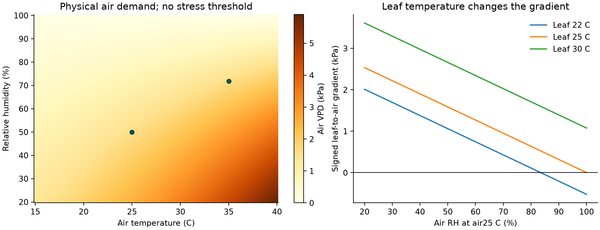
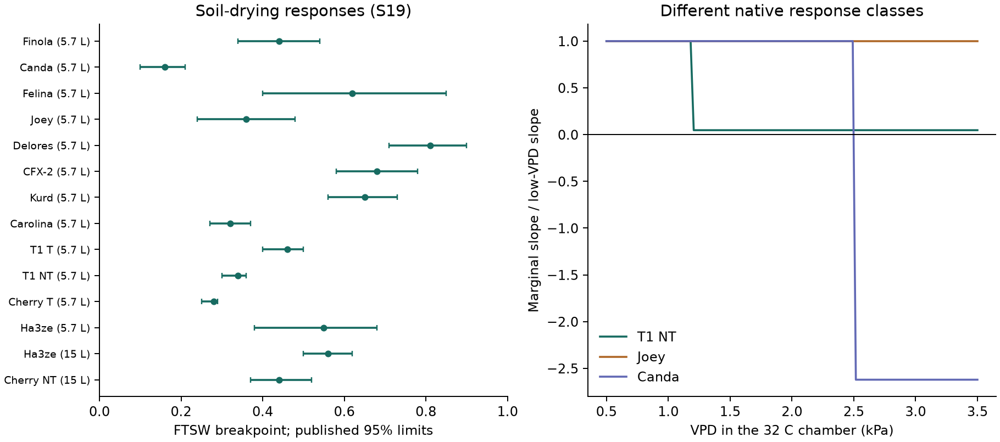
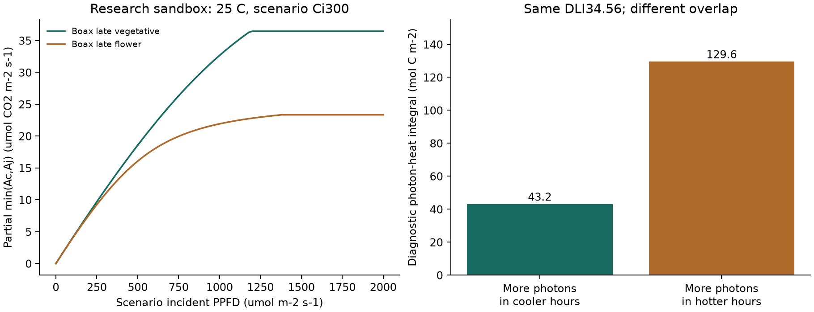

# WeedGrow - Environmental interactions - and warning specification

v7.0 | CANNABIS RESEARCH, COMPUTATIONAL FEATURES AND REFERENCE MODEL | 29 OCTOBER 2026

This revision adds fifteen primary cannabis/hemp studies to the environmental model. It focuses on combinations: air temperature with humidity and light, atmospheric demand with root supply, developmental stage with tissue and history, and salinity with water availability.

A single universal "optimal grow environment" is not supported by these studies. This spec separates measurable physical conditions, native experimental responses, research simulations and operational care decisions. No numerical improvement in field accuracy is claimed.

## What is concrete in this version

- Paired VPD, signed leaf-to-air gradients, complete light/radiation integrals and heat-light/heat-VPD overlap features.
- Published native stomatal breakpoints and six hemp biochemical-capacity profiles, with strict research domains.
- A small executable physiology sandbox and 288 factorial input scenarios; 201 passing reference checks.
- All 14 warning detectors retained, with explicit eligibility, weights, missing-data rules and integration boundaries.

Twelve new studies were reviewed from full text; three have limited primary-source access, disclosed in the evidence ledger. The package preserves the v6 warning mathematics and all 89 prior factor mappings. New physiology features add explanations and research inputs; they do not silently upgrade old engineering weights into fitted effects.

This is the next environmental/warning spec. The v5.2 storage/permissions/water-balance contracts continue where not superseded. Routine users log watering; one-time setup and optional calibration support the model. Daily moisture checks are not required. No production app code was changed.

<!-- page break -->

# 01  Decisions from the deeper research

WHAT CHANGES IN THE ALGORITHM

| Finding | v7 requirement |
| --- | --- |
| Water demand can be nonlinear in atmospheric dryness. | Use continuous paired air VPD as a physical input; represent stomatal-response uncertainty. Never assume actual water use rises proportionally without limit. |
| Heat and light can affect carbon gain and water loss differently. | Separate environmental exposure, potential demand, actual reserve and physiological impairment. Do not build a single health percentage from all four. |
| Developmental and exposure histories matter. | Keep current tissue/stage, dated size, recent root state, local light exposure and prior episodes. A daily mean or chronological age alone is insufficient. |
| Some apparent environmental effects are confounded. | Record ventilation/chamber, genotype, substrate, time and controls. Do not convert a treatment contrast into a universal causal coefficient. |
| Useful process models exist for hemp. | Start from coupled water supply, stomata and photosynthetic limitations. Bench-test a full port before allowing it to influence field care. |
| Weather cannot measure every required state. | Return a scoped uncertainty for missing root/canopy/leaf facts, while preserving independent hazard and symptom routes. |

The immediate gain is a better representation of what the inputs mean and how they interact. The new reference calculates supported physical features and exposes native response heterogeneity. Predicting actual injury, infection or watering time still requires a supported model state and validation against the intended endpoint.

<!-- page break -->

# 02  What "optimal" means

DEFINE THE ENDPOINT, TISSUE, TIMESCALE AND DOMAIN FIRST

| Endpoint | Why its optimum is different |
| --- | --- |
| Instantaneous leaf photosynthesis | A minutes-long chamber response on one leaf; affected by leaf temperature, internal CO2, age, nutrition and light. |
| Whole-plant condition over days | Includes root supply, canopy structure, respiration, stress history and recovery; cannot be reconstructed by copying a peak leaf reading. |
| Rootless-cutting survival/rooting | Water supply is constrained by establishment. A humidity response in a cutting is not an adult flowering-plant target. |
| Disease-conducive conditions | Can overlap with conditions that support physiological function; pathogen presence and susceptible tissue remain separate. |
| Growth/biomass over weeks | Depends on intercepted light, developmental timing and resource allocation. A larger concentration or better efficiency is not necessarily a larger absolute output. |
| Avoiding damage | Requires an injury endpoint. Photosynthesis below its maximum does not establish irreversible injury or a rescue action. |

## Evidence labels

PUB = a published number retained with its domain; DER = transparent calculation from source data or physics; ENG = an engineering feature/policy choice; CAL = needs target-domain calibration. Add design labels: JOINT = factors tested together; SEPARATE = distinct experiments; ASSOCIATION = covariation; PHYSICS = a physical identity. A paper can have several design labels for different findings.

A three-factor article title does not establish a complete factorial experiment. A statistically significant interaction is endpoint- and scale-specific. A non-significant interaction does not prove independence; it does prevent claiming a measured synergy without adequate evidence.

<!-- page break -->

# 03  New evidence: light, heat and history

PRIMARY CANNABIS STUDIES; DESIGNS DETERMINE TRANSFERABILITY

| Study / access | Design and useful result | Algorithm decision |
| --- | --- | --- |
| S16 Chandra2008; abstract | JOINT acute light/temperature; CO2 tested separately. Carbon gain and water loss differed. | Paired heat-light features, separate outcomes; no invented triple-factor coefficients. |
| S17 Tang2017; partial | Leaf N and temperature physiology; model parameters investigated. | Nutrient capacity belongs in a full model; weather cannot infer leaf N. |
| S20 Rodriguez-Morrison2021; full | Local leaf light response changed across development; leaf saturation did not directly predict whole-plant behavior. | No simple sun-to-plant-health score or saturation-to-damage conversion. |
| S21 Bauerle2020; full | Leaf age after expansion and crown position/light treatments. | Leaf cohort age matters; plant age is an imperfect proxy. |
| S29 Holweg2025; abstract | Two genotypes, three light levels, four cycles under two air-temperature regimes. | Chronic exposure and genotype can change outcomes; no universal optimum from acute leaf tests. |
| S30 Collado2025; full | Static/dynamic light histories and short-term light responses; plot/subplot mixed models. | Retain exposure history; instant light and long-term acclimation can affect water use differently. |

Sources: [S16](https://pmc.ncbi.nlm.nih.gov/articles/PMC3550641/) [S17](https://onlinelibrary.wiley.com/doi/full/10.1111/gcbb.12451) [S20](https://www.frontiersin.org/journals/plant-science/articles/10.3389/fpls.2021.646020/full) [S21](https://www.mdpi.com/2223-7747/9/2/271) [S29](https://research.wur.nl/en/publications/high-air-temperature-reduces-plant-specialized-metabolite-yield-i/) [S30](https://www.nature.com/articles/s41598-025-27437-4). These results constrain the architecture; they do not identify one shared response surface across all genotypes, rooting domains and weather patterns.

<!-- page break -->

# 04  New evidence: water supply and canopy function

MEASURED RESPONSE IS STRONGER THAN A GENERIC OPTIMAL-RANGE CHART

| Study / access | Design and useful result | Algorithm decision |
| --- | --- | --- |
| S18 Tang2018; full | Water/N supply and canopy structure; coupled sun/shade gas-exchange model. | Separate potential demand from available water and actual stomatal regulation. |
| S19 Sheldon2021; full | Soil dry-down and 32 C VPD trials were separate; cultivar responses differed. | Use profiles/ensembles; do not multiply two independent trial curves as a measured joint response. |
| S22 Mateva2024; full | Three genotypes, water treatments, light-response measurements and recovery. | Water regime alters light response and photoprotection; preserve recovery history. |
| S23 Yuan2024; full | Salt/drought/inoculation with selected combined treatments. | Moist medium can still limit uptake through osmotic effects; do not infer a complete factorial surface. |
| S24 Pena2025; full | Two clones; water treatment and genotype effects; separate days for moisture levels. | Use endpoint-specific effects and contemporaneous controls. Most interactions were not dominant. |
| S28 Pangle2025; full | Repeated field measurements, leaf light/CO2 curves, two cultivars, late-season decline. | Native capacities seed a research sandbox; age, N and season are confounded. |

Sources: [S18](https://www.frontiersin.org/journals/plant-science/articles/10.3389/fpls.2018.00951/full) [S19](https://doi.org/10.1080/15427528.2021.1883175) [S22](https://www.frontiersin.org/journals/plant-physiology/articles/10.3389/fphgy.2024.1441262/full) [S23](https://www.mdpi.com/2309-608X/10/4/283) [S24](https://www.mdpi.com/2223-7747/14/24/3840) [S28](https://journal.wildlife.ca.gov/2025/12/29/hemp-physiological-response-to-seasonal-variation-in-photosynthetic-capacity-for-two-high-yield-cannabidiol-cbd-cultivars/). Stomatal closure can reduce transpiration while the plant remains under stress. Thus lower modeled water loss must not be reported as improved plant condition.

<!-- page break -->

# 05  New evidence: humidity and establishment

A CONTEXT-DEPENDENT RESPONSE, NOT ONE RH TARGET

| Study | What was tested | What cannot be concluded |
| --- | --- | --- |
| S25 Humidity2025; full | 20 clones of one genotype, 10/treatment; low/high canopy RH with manually changed air exchange. | A pure RH effect size, clear independent chamber replication, or validated leaf VPD from an assumed leaf offset. |
| S26 Cold2025; full | One day-neutral inbred population; constant/fluctuating cold regimes over extended exposure in two runs. | A universal frost-survival deadline, general thermal-time base or weather-only flowering date. |
| S27 Cuttings2025; full | Two cultivars, six cuttings/treatment; separate light/RH/T experiments; substrate changed for T. | A fully crossed light x RH x T response, adult root-temperature optimum, or adult humidity target. |

S27 supports an establishment-specific water-balance context. S25 supports concern about prolonged humid/poor-exchange conditions but is unsuitable for fitting an isolated humidity coefficient. These are compatible findings at different developmental stages and experimental designs. [S25](https://www.frontiersin.org/journals/plant-science/articles/10.3389/fpls.2025.1678142/full) [S27](https://www.hst-j.org/articles/xml/O4qy/)

Use rooted/unrooted/recently transplanted status when known. Do not infer root completion merely from clone age. Users should not have to inspect roots daily; initialize a broad establishment profile, then update from a meaningful setup event or optional observation.

Chilling can alter appearance and development without proving disease. Keep cold exposure, reported discoloration and pathogen review separate. A purple leaf, wilt or slowed growth has multiple possible causes. [S26](https://doi.org/10.1186/s42238-025-00311-w)

<!-- page break -->

# 06  The environmental interaction model

A CAUSAL STRUCTURE BEFORE COEFFICIENTS

| Path | Joint mechanism | Observable inputs and missing state |
| --- | --- | --- |
| Air T + RH -> demand | Saturation pressure and actual vapor pressure determine air VPD. | Paired T/RH; leaf temperature/boundary layer remain separate. |
| Light + T -> physiology | Light-driven electron transport and temperature-dependent biochemical processes can co-limit carbon gain. | PPFD and leaf T; leaf N, Ci and genotype parameters often unavailable. |
| Demand + roots -> water status | Atmospheric demand competes with hydraulic supply; stomata respond. | ET0/VPD plus supported reserve/root model; weather alone cannot determine root supply. |
| Stomata -> water/carbon/temperature | Closure alters CO2 entry, transpiration and cooling, linking heat and water stress. | Plant parameters or measured calibration needed for numerical feedback. |
| Rain + exposure + medium -> roots | Reception, infiltration, storage and drainage govern retained input. | Separate soil/canopy rain reception; medium profile and active root volume. |
| Humidity/wetness + tissue + pathogen | A shared weather episode changes disease-conducive conditions. | Flower/foliage, local wetness, history; no pathogen detection from climate. |
| History + stage -> present capacity | Acclimation, leaf aging, development and recovery change the response. | Dated events and rolling exposures; plant age alone is insufficient. |

Do not add T, RH, VPD, ET0, dew and rain as independent severity votes when they describe shared causes. VPD is derived from T/RH, and ET0 already combines weather factors. Additional modifiers require evidence that they explain residual behavior or a distinct endpoint.

<!-- page break -->

# 07  Temperature x light: what is supportable

SEPARATE SHORT EXPOSURE FROM A CHRONIC RESPONSE

The acute cannabis study tested temperature/light combinations and reported different carbon-gain and water-loss responses. The 2011 multi-genotype study already in v6 likewise found differing temperature responses. These observations support interaction and genotype scope; they do not define one outdoor air-temperature optimum. [S16](https://pmc.ncbi.nlm.nih.gov/articles/PMC3550641/) [S03](https://pmc.ncbi.nlm.nih.gov/articles/PMC3550580/)

The 2025 chronic study tested two genotypes, three light levels and contrasting day/night temperature regimes across four cycles. Its primary abstract reports genotype-dependent long-term outcomes. It does not provide enough accessible design detail here to extract independent interaction coefficients or identify the temperature at which an adverse response begins. [S29](https://research.wur.nl/en/publications/high-air-temperature-reduces-plant-specialized-metabolite-yield-i/)

## Study-specific response windows, not universal targets

| Source endpoint | Reported response | Limit |
| --- | --- | --- |
| Acute leaf photosynthesis [S16](https://pmc.ncbi.nlm.nih.gov/articles/PMC3550641/) | Reported temperature optimum25-30 C in its tested light conditions. | A chamber response; not a long-term air-temperature target. |
| Multi-genotype leaf photosynthesis [S03](https://pmc.ncbi.nlm.nih.gov/articles/PMC3550580/) | Optima differed across genotypes, approximately25-35 C. | No universal cultivar coefficient or damage boundary. |
| Hemp leaf capacity [S17](https://onlinelibrary.wiley.com/doi/full/10.1111/gcbb.12451) | Light-saturated response plateaued around25-35 C and declined above35 C. | Leaf N and assay conditions matter; not an adult-root optimum. |
| Chronic temperature comparison [S29](https://research.wur.nl/en/publications/high-air-temperature-reduces-plant-specialized-metabolite-yield-i/) | Compared day/night25/21 versus31/27 C across cycles. | Two regimes cannot identify a precise optimum or onset threshold. |

## v7 feature contract

```
Keep separate:
  airTempC, qualified leafTempC / explicit scenario bounds
  paired PPFD or validated radiation feature
  exposure duration and light history
  current tissue/stage, establishment and root supply
Compute joint overlap only over the same covered intervals.
```

The sandbox adds photon-heat and heat-VPD integrals as diagnostic features, not injury equations. Their reference origin of 30 C is ENG and explicitly versioned. They can distinguish otherwise identical daily summaries; no multiplier turns them into percentage damage.

No automatic shade or water action follows from a partial photosynthesis model. The operational heat card remains an attributed weather exposure; water advice continues to depend on supported reserve and current root evidence. A change that reduces light may affect demand and disease drying differently, so retain all relevant channels.

<!-- page break -->

# 08  VPD is useful but not a plant diagnosis

PAIRED AIR DATA AND LEAF TEMPERATURE HAVE DIFFERENT MEANINGS



```
es(T)=0.6108*exp(17.27*T/(T+237.3))   [kPa]
ea=es(Tair)*RH/100
D_air=es(Tair)-ea
D_leaf=es(Tleaf)-ea                   [signed]
Do not assume Tleaf=Tair or apply a fixed offset.
```

The saturation-pressure equation is PUB physics [S11](https://www.fao.org/4/X0490E/x0490e0e.htm). The leaf-gradient calculations use explicitly supplied sensor/model/scenario bounds. A negative signed gradient indicates a thermodynamic tendency toward condensation under those conditions, not an observation of dew or a plant-specific wetness duration.

At 25 C/50% RH and 35 C/71.83% RH, air VPD is about 1.584 kPa in both cases. Their heat exposure differs. At air25 C/RH90%, explicit leaf22-23 C scenarios have a negative gradient, while leaf28-30 C scenarios have a positive one. These are physical counterfactuals, not inferred leaf temperatures.

<!-- page break -->

# 09  Native soil and VPD response variation

PUBLISHED NUMBERS THAT SHOULD REPLACE UNIVERSAL ASSUMPTIONS



Left: published soil-drying breakpoints with source confidence limits. Right: the ratio of the reported post-break marginal slope to the low-VPD slope for three example response classes. This ratio is not total transpiration or a water-dose multiplier. Negative slopes are retained rather than hidden. [S19](https://doi.org/10.1080/15427528.2021.1883175)

In Table 1, native point estimates span FTSW0.16-0.81. FTSW is a mass-based fraction of experimentally transpirable water, with an experimental endpoint at normalized transpiration <=0.1. It is not volumetric water content, pot percent wet, field capacity or a FAO depletion fraction.

Table 2 contains seven segmented and five linear rows in the tested VPD range0.5-3.5 kPa at air32 C. The abstract/body counts conflict; the registry preserves every row and the discrepancy. Repeated plant observations are not independent plants. No prevalence of a trait in arbitrary cannabis users is inferred.

v7 consequence: unknown cultivar physiology remains an ensemble/domain problem. The app must not assign an "indica" or "sativa" label to one measured curve, or identify a universal2 kPa stress boundary. These breakpoints describe regulation, not a safe zone or mandatory watering point.

<!-- page break -->

# 10  Plant age, stage, size and recovery

THE FIELDS MATTER THROUGH PHYSICAL AND BIOLOGICAL STATES

| Available fact | Valid use | Invalid shortcut |
| --- | --- | --- |
| Dated plant age | Developmental context and profile evolution. | Age alone determines leaf area, rooting depth or water use. |
| Stage / actual tissue | Flower/foliage relevance, establishment and current care scope. | Every flowering plant has the same capacity or susceptibility. |
| Dated height / canopy size | Physical geometry, interception/model priors and preparation advice. | Height is proportional to leaf area or root water reserve. |
| Leaf age distribution | Potential research photosynthesis correction when measured. | Apply a leaf-age equation to chronological plant age. |
| Watering / rain history | Input timing and supported retention; uncertainty after unmeasured events. | Logging water means root reserve and physiology instantly recovered. |
| Repot / move / medium change | Revalidate rooting, hydraulic profile, exposure location and calibration. | Carry old canopy/medium coefficients as current measurements. |

Leaf aging is supported by S21; seasonal capacity changes are supported by S28. Neither isolates a universal chronological-stage coefficient. In S28, development, season, N and physiological age covaried. The measured profile capacities are useful priors for a research model, not a forecast of every late-flowering plant. [S21](https://www.mdpi.com/2223-7747/9/2/271) [S28](https://journal.wildlife.ca.gov/2025/12/29/hemp-physiological-response-to-seasonal-variation-in-photosynthetic-capacity-for-two-high-yield-cannabidiol-cbd-cultivars/)

S22 and S24 support drought-related regulation and differing physiological limitations. Maintain relevant drought/recovery episodes, without inventing a universal recovery half-life. No-watering and water-now remain root-state decisions; the physiology channel can remain unassessed. [S22](https://www.frontiersin.org/journals/plant-physiology/articles/10.3389/fphgy.2024.1441262/full) [S24](https://www.mdpi.com/2223-7747/14/24/3840)

<!-- page break -->

# 11  Medium, salinity and root temperature

WHY WEATHER AND POT LITRES CANNOT REVEAL ALL ROOT PROBLEMS

Water availability is not simply the amount of liquid present. Osmotic conditions can impair uptake in moist medium. S23 tested selected salt/drought combinations and biological context, showing why a weather-only model cannot identify this cause. The incomplete combination matrix does not support fitting all salt x drought x inoculation cells. [S23](https://www.mdpi.com/2309-608X/10/4/283)

| Factor | Required evidence / implementation |
| --- | --- |
| Hydraulic medium properties | A supported retention/drainage profile or calibration; provenance categories do not establish texture. |
| Active rooting volume | Distinguish full pot volume from accessible reserve; ground roots may access unmeasured layers. |
| Salinity / nutrients | A measured, method-specific EC/nutrient record if used numerically. Bulk-soil, pore-water and nutrient-solution EC are not interchangeable. |
| Root oxygen / saturation | Qualified abnormal pooling or supported excess beyond normal drainage. Moist soil is not proof of oxygen limitation. |
| Root temperature | A scoped sensor/validated thermal model. No fixed root-temperature offset from air. |
| Root disease | Symptoms and appropriate diagnostic evidence; climate can supply context, not a causal organism. |

No sufficiently characterized adult-cannabis root-zone temperature response was verified in this review for a universal numerical care coefficient. Commercial claims are not used as peer-reviewed coefficients. The cutting study varies growth-chamber temperature and substrate context; it does not calibrate an adult root-zone temperature model. [S27](https://www.hst-j.org/articles/xml/O4qy/)

When supply remains unknown, preserve a broad reserve interval or ask a targeted optional check/calibration. Do not ask novices to estimate hydraulic conductivity or daily root oxygen. A useful algorithm should identify the specific missing state instead of claiming weather pinpoints it.

<!-- page break -->

# 12  Weather and measurement contracts

A PRECISE CALCULATION STILL FAILS WITH THE WRONG INPUT

| Input | Contract | Excluded substitute |
| --- | --- | --- |
| T/RH | Same interval, location epoch, source nature and valid units. | Daily T maximum paired with a different RH extreme. |
| PPFD / PAR | Measured photons or a disclosed validated transformation. Integrate interval mean rates. | UV index, sunny icon, full-sun category or uncalibrated lux conversion. |
| Broadband shortwave | W/m2 interval mean -> MJ/m2 by duration; retain method. | Treat broadband watts as PPFD without a spectrum/method. |
| Reference ET0 | Well-watered reference grass; preserve interval/units/method. | Actual plant transpiration, pot litres or root moisture. |
| Grid land ET / soil moisture | Model-cell surface/vegetation assumptions; separate product. | A measurement of the user's pot or garden root zone. |
| Leaf/root temperature | Scoped sensor or validated model; scenarios labelled. | A permanent air-temperature offset. |
| Rain | Received/infiltrated/retained stages distinct; soil and canopy reception separate. | PoP becomes water; forecast becomes observed by ageing. |

An optional Open-Meteo adapter could add shortwave radiation and FAO ET0. Its documentation distinguishes preceding-hour means, instantaneous values and interval sums. It also distinguishes reference ET0 from model land evapotranspiration. These definitions must survive normalization; no provider switch was performed. [S33](https://open-meteo.com/en/docs)

Provider generic statements about VPD do not override cannabis response evidence. Preserve field-level validity: a bad RH must not discard valid wind or light; a valid hazard feed must survive a missing numeric weather stream. Archive forecasts as issued for honest replay. [S19](https://doi.org/10.1080/15427528.2021.1883175) [S12](https://openweathermap.org/api/one-call-3)

<!-- page break -->

# 13  Computed features and units

QUANTITATIVE FEATURES WITHOUT INVENTED BIOLOGICAL WEIGHTS

```
DLI = sum(PPFD_i * seconds_i) / 1,000,000
Shortwave MJ/m2 = sum(Wm2_i * seconds_i) / 1,000,000
VPD exposure = sum(D_air_i * hours_i)  [kPa h]
Heat-VPD overlap = sum(max(Tair_i-30,0)*D_air_i*hours_i)
Photon-heat overlap = sum(PPFD_i*seconds_i/1e6
                         * max(Tair_i-30,0))
```

The first two are unit integrations; VPD comes from physical calculations. The overlap integrals are ENG diagnostic features: their origin30 C is a versioned reference, not an experimentally identified injury threshold. They have no automatic severity coefficient or damage percentage.

## Coverage rules

- Full-day DLI, reference ET totals and complete means require full qualified coverage in this reference. Partial totals are explicitly known sums; do not fill missing hours with zero.
- The normalized producer supplies the actual plant-local day length, including23/25-hour daylight-saving days. A rolling24h exposure and a local calendar day are distinct windows.
- Keep actual/retrospective and forecast lanes separate. Interval means/sums must refer to compatible boundaries; a future forecast never updates current storage.
- Day/night means are labelled known means over assessed day/night hours, with coverage. No nighttime from RH alone.
- No assumed leaf temperature. Signed leaf gradients require a scoped source or explicit scenario and never become observed dew.

Keep source timestamp, availability time, valid interval, provider/method, units, location epoch, quality and uncertainty outside the scalar core. They are required producer contracts, not implemented provider ingestion. Thermal/illumination histories can be retained as raw features without inventing a biological memory half-life.

<!-- page break -->

# 14  The physiology emulator: useful but scoped

A PARTIAL BIOCHEMICAL SANDBOX USING NATIVE HEMP CAPACITIES

```
q=alpha*PPFD
J=(q+Jmax-sqrt((q+Jmax)^2-4*theta*q*Jmax))/(2*theta)
Ac=Vcmax*(Ci-GammaStar)/(Ci+Km)
Aj=J*(Ci-GammaStar)/(4*(Ci+2*GammaStar))
Output = min(Ac,Aj) before respiration and other limits
```

| Parameter / source | Value / domain |
| --- | --- |
| Native capacities [S28](https://journal.wildlife.ca.gov/2025/12/29/hemp-physiological-response-to-seasonal-variation-in-photosynthetic-capacity-for-two-high-yield-cannabidiol-cbd-cultivars/) | Six Boax/Cherry-Wine stage/date profiles for Vcmax and Jmax, scaled to25 C. |
| Shared table constants [S28](https://journal.wildlife.ca.gov/2025/12/29/hemp-physiological-response-to-seasonal-variation-in-photosynthetic-capacity-for-two-high-yield-cannabidiol-cbd-cultivars/) | alpha .24; theta .85; GammaStar42.7497; Km710.3131; pressure100 kPa. |
| Input Ci | Explicit internal-CO2 scenario. No automatic Ci from ambient CO2 or weather. |
| Temperature | 25 C only in this reference; no generic temperature-response extrapolation. |
| Output | Partial biochemical limitation, not net exchange, growth, water use, injury or yield. |
| Omissions | Respiration, TPU limitation, mesophyll/stomatal conductance, energy balance, water supply and canopy scaling. |

The architecture follows established model terms [S31](https://journals.plos.org/plosone/article?id=10.1371/journal.pone.0143346) [S32](https://remkoduursma.r-universe.dev/plantecophys/doc/manual.html). This is a deliberately partial Python implementation, not an execution or reproduction of the full plantecophys package or original field fit. Native parameters are experimental priors, not the user's measured capacities.

Important correction: the source text broadly says parameters were corrected to25 C, but its footnote specifically names Vcmax/Jmax. The software documentation says TPU is not automatically temperature-corrected. Accordingly no TPU25 value is invented. Generic temperature defaults also depend on software version and are not a cannabis calibration. [S28](https://journal.wildlife.ca.gov/2025/12/29/hemp-physiological-response-to-seasonal-variation-in-photosynthetic-capacity-for-two-high-yield-cannabidiol-cbd-cultivars/) [S32](https://remkoduursma.r-universe.dev/plantecophys/doc/manual.html)

<!-- page break -->

# 15  Emulator results and matched-summary cases

SIMULATION EXPOSES LOST INFORMATION; IT DOES NOT CREATE OUTCOMES



Left: source capacities change a partial light/CO2 calculation at fixed25 C and an explicit Ci300 scenario. No curve is a whole-plant prediction. Right: two constructed days have identical DLI34.56 mol/m2, identical weather summaries and different timing of photons relative to hot hours.

| Executed counterfactual | Result | Implication |
| --- | --- | --- |
| Same air VPD;25 C/50% versus35 C/71.83% | Both1.584 kPa; heat-VPD overlap differs. | VPD alone cannot represent thermal exposure. |
| Same DLI; photons in cooler versus hotter hours | Photon-heat diagnostic43.2 versus129.6 mol C/m2. | A total-light feature loses timing; the3x index is not3x biological damage. |
| Same air25 C/RH90%; cooler versus warmer leaf scenarios | Leaf gradient can change sign. | Measured/qualified leaf temperature matters; no fixed offset. |
| Same weather; different supported reserve margins | water_now / not_due / uncertain remain distinct. | Demand features must not override root-state evidence. |

The factorial sandbox varies6 temperatures x4 RH values x4 light values x3 explicitly supplied root states =288 input scenarios. It computes features and conditional care decisions from supplied reserve/excess states; it never infers those roots from the synthetic climate. It does not generate actual transpiration, infection, injury or growth labels. Do not use the outputs as empirical training/validation outcomes.

<!-- page break -->

# 16  From research model to a useful algorithm

WHAT CAN RUN NOW AND WHAT STILL NEEDS PARAMETERS

| Component | Current status | Next evidence needed |
| --- | --- | --- |
| Paired VPD / energy / DLI | Deterministic feature calculation implemented. | Provider interval validation; canopy/plant exposure matching. |
| Native stomatal comparators | Published rows and response classes implemented as research outputs. | Local genotype/profile transfer and actual leaf-area/water-loss measurements. |
| Partial biochemical emulator | Implemented at25 C with source profiles and explicit Ci. | Respiration, stomatal/mesophyll behavior, water supply and energy balance before field prediction. |
| Root reserve / drainage | Required physical producer; not implemented by the new feature layer. | Hydraulic profiles, active roots, retention and initialization/calibration. |
| Environmental injury probability | Not estimated. | Time-resolved cannabis injury/recovery endpoints and held-out validation. |
| Disease probability | Not estimated. | Pathogen/host outcomes, local microclimate and independent assessments. |
| v6 attention weights | Retained ENG research priors. | Prospective comparison; new studies do not automatically fit their values. |

Recommended architecture: physical features -> supported reserve/hydraulic state -> domain-limited physiological model -> separately gated warning decisions. Fit only residual relationships that have outcome data. Preserve native model class/parameter uncertainty rather than averaging every paper into one apparently precise plant score.

<!-- page break -->

# 17  All warnings: weather and destructive events

RETAINED RESEARCH SCORE BUDGETS AND MANDATORY ELIGIBILITY

| ID | Gate / combination | Score and boundary |
| --- | --- | --- |
| W01 Heat | Valid peak >=32 C OR applicable source heat product. | 65% intensity +35% heat dose; new paired exposure features explain context, not fitted injury. |
| W02 Cold | Valid minimum <=5 C OR applicable cold/frost/freeze product. | 70% minimum intensity +30% cold dose. <=2 possible frost; <=0 air freezing; no tissue-ice claim. |
| W03 Wind | Gust >=15 OR sustained >=10 m/s OR source product. | 80% gust +20% sustained; missing one cannot veto the other valid route. |
| W04 Rain | Rate >=10 mm/h OR complete24h >=25 mm OR source product. | 50% rate +50% complete amount; no retained-root-water inference. |
| W05 Hail/severe | Explicit mapped, applicable source event. | No inferred hail from rain+gust; source severity remains attributed. |

```
ramp(x;a,b)=clip((x-a)/(b-a),0,1)
W01=100*[.65*ramp(Tpeak;30,40)+.35*(1-exp(-DH30/24))]
W02=100*[.70*ramp(5-Tmin;0,10)+.30*(1-exp(-DH5/48))]
W03=100*[.80*ramp(gust;10,25)+.20*ramp(mean;6,16)]
W04=100*[.50*ramp(rate;2,20)+.50*ramp(total24;10,50)]
```

All screens, curves and outer weights above are ENG; DH30/DH5 integrate temperature excess above30/below5 in degree-hours. An independent source event has no synthetic score. None is a validated cannabis injury probability. Stage, stability, shelter and current roots change action context without inventing new injury coefficients.

<!-- page break -->

# 18  All warnings: roots, water and context

PHYSICAL STATES ARE NOT A WEIGHTED WEATHER GUESS

| ID | Gate / combination | v7 behavior |
| --- | --- | --- |
| W06 Watering | Supported reconciled joint reserve-minus-action-threshold margins. | All<0 water_now; all>0 not_due; overlap/zero uncertain. No VPD/DLI-only water instruction. |
| W07 Root excess | Qualified current abnormal pooling OR supported excess AND beyond normal drain window. | 70% excess magnitude +30% persistence. Normal moisture is not waterlogging. Pooling prompts attention without waiting for laboratory duration. |
| W08 Container heat | Pot AND [(heat AND qualified pot solar/hot-contact) OR supported root-temperature screen]. | Inherit W01 once. No air-to-root offset or universal adult root-temperature coefficient. |
| W09 Dampness/dew | Supported paired-night episode OR explicit scoped fog. | Context only, no extra disease vote or root-water credit. Producer still needs local wetness benchmarking. |
| W13 Establishment | Vulnerable establishment AND W07; independent reported establishment problem. | Append context to W07. No fixed-age damping-off diagnosis. |
| W14 Root/wilt | W07 OR qualified current root/wilt report. | One problem-review route; cause unknown; merge with W07/W13. |

W07 normalizers require a supported profile for excess magnitude and persistence. Qualified abnormal pooling has an ENG attention floor60 and an immediate care route; absent root data is unknown. The S08 cannabis laboratory duration/stage reconstruction remains a separate comparator, not an irrigation threshold, a root-rot probability or a safe waiting period. [S08](https://www.mdpi.com/2673-7655/6/5/90)

Rain has two reception fields: soil and canopy, each yes/partial/no/unknown. A roof can keep soil dry while another canopy surface receives rain; a regional rain report never automatically refills roots. Conflicting qualified pooling and model water_now require reconciliation.

<!-- page break -->

# 19  All warnings: foliage and flower conditions

TISSUE GATES + EXPOSURE + BOUNDED CONTEXT

| ID | Primary A | Context B at nominal20% budget |
| --- | --- | --- |
| W10 PM | Paired PM temperature/RH kernel, accumulated over a supported window. | 50% crowding/poor airflow;30% local history;20% verified susceptibility. Nominal contributions10/6/4 points. |
| W11 Bud rot | max(humid-air exposure, eligible wet-event curve envelope). Flowers required. | 40% density/slow drying;30% fresh damage;30% history. Nominal8/6/6 points. |
| W12 Wet leaf | 25 x TOMCAST DSV comparator with wetness uncertainty. Foliage required. | 50% splash/debris;30% poor drying;20% history. Nominal10/6/4 points. |

```
Nominal S=.80*A+.20*B
Sensitivity core weights={.70,.80,.90}; retain min/max
Known tissue AND qualified route/coverage are mandatory
Core lower>=25 AND score lower>=35 -> conditions_watch
Only upper bounds qualify -> conditional_watch
Lower>=65/80 -> elevated/strong exposure under this policy
These are attention points, not percentages of disease.
```

Context alone cannot create eligibility. Unknown context remains0-100 as appropriate; do not renormalize to available fields. Reported powdery growth, flower problems or leaf spots use independent current problem-review routes. Absence of a report is not evidence of absence of disease.

W11 retains two grape tissue-response curves to expose transfer disagreement, not to estimate cannabis infection odds. W12 is a wet-leaf comparator, not cannabis Septoria detection. The new physiological studies do not validate these disease thresholds. Pathogen, tissue and microclimate remain separate. [S01](https://ipm.ucanr.edu/disease/database/grapebotrytis.html) [S10](https://bpb-us-e1.wpmucdn.com/blogs.cornell.edu/dist/1/8867/files/2019/08/draft-veg-tomato-diseases.pdf) [S13](https://horticulture.oregonstate.edu/nursery/nursery/disease-triangle)

<!-- page break -->

# 20  Retained disease feature mathematics

EXPLICIT PRIORS; NEW RESEARCH DOES NOT MAKE THEM MEASURED EFFECTS

```
E=integral(recency(t)*f(T(t),RH(t)) dt)
A=100*(1-exp(-E/E_star))
PM f=trapezoid(T;8,18,26,35)*clip(RH/50)
     *[.5+.5*ramp(RH;50,90)]
Humid Botrytis f=trapezoid(T;5,15,25,35)*ramp(RH;65,95)
Occurred history72h; recency half-life48h
Forecast next24h evaluated separately; recency=1
E_star: PM12h; humid Botrytis8h
Scale sensitivity +/-25%; supported wet PM factor range .5-1
```

These kernels/scales are retained ENG. PM evidence rejects85% RH as a necessary condition but does not fit this response curve. The kernel may classify ordinary weather as conducive; specificity is a priority failure test. Independently supported wetness can widen sensitivity, but rain probability never supplies protection. [S04](https://www.frontiersin.org/journals/plant-science/articles/10.3389/fpls.2025.1543229/full) [S06](https://www.tandfonline.com/doi/full/10.1080/07060661.2026.2649769) [S07](https://apsjournals.apsnet.org/doi/10.1094/PDIS-07-25-1591-RE)

```
Wet-event berry I=-2.647866-.374927W+.061601WT-.001511WT^2
E_berry=100/(1+exp(-I))
Flower Q=exp(-((T-23.7)/10.5)^2)
E_flower=95.6*(1-exp(-(Q*W/1.3)^2))
Use envelope of both only in joint tested domain:
  mean wet-event T12-30 C; wet duration4-20h
```

Coefficients are PUB grape models; the envelope is ENG structural sensitivity. Estimated wet hours use +/-3h stress scenarios; crossing the tested domain broadens/unassesses rather than clamping to safety. This is not a confidence interval. [S01](https://ipm.ucanr.edu/disease/database/grapebotrytis.html)

W12 retains the source TOMCAST lookup only, with temperature rows13-17/18-20/21-25/26-29 C, corresponding full-wet-hour cut points6/15/20/24;3/8/15/22;2/5/12/20;3/8/15/22. Maximum DSV3 in the first row,4 otherwise. No full clock/reset/spray implementation is claimed. Source core and configuration contain the complete executable lookup. [S10](https://bpb-us-e1.wpmucdn.com/blogs.cornell.edu/dist/1/8867/files/2019/08/draft-veg-tomato-diseases.pdf)

<!-- page break -->

# 21  Water balance and physiological feedback

THE REQUIRED BRIDGE BETWEEN WEATHER AND WATER / NOT-DUE

```
Reserve_next=Reserve_now+retainedIrrigation+retainedRain
             -plantUptake-mediumEvaporation-drainage
Demand side: qualified ET0 / energy / VPD / plant exposure
Supply side: medium, active roots, reserve, salinity, aeration
Stomatal feedback: potential demand != actual uptake
Root decision: supported joint-scenario margins, not points
```

The FAO root-zone balance remains the physical foundation [S11](https://www.fao.org/4/X0490E/x0490e0e.htm). Native work supports coupling water supply and stomatal behavior [S18](https://www.frontiersin.org/journals/plant-science/articles/10.3389/fpls.2018.00951/full) [S19](https://doi.org/10.1080/15427528.2021.1883175). The new feature layer does not implement a validated reserve/soil producer, and cannot infer unknown initial storage from a few days of weather.

A South African field Kc can seed only a matching ground profile, not pot litres. The v6 source values initial.70, development.75, mid-season.77, mature.66 remain PUB domain-limited references [S02](https://pmc.ncbi.nlm.nih.gov/articles/PMC12398160/). Do not combine this field crop coefficient with extra VPD/temperature multipliers that double-count demand without residual calibration.

## Low-burden alternatives

- Use validated setup/profile ranges and routine watering logs to propagate a reserve interval where supported.
- Allow a one-time pot-mass or optional moisture/sensor calibration when it materially reduces initialization uncertainty.
- When unknown event volume/retention or a medium change makes the decision ambiguous, identify that specific uncertainty. A targeted check is an exception, not the everyday algorithm.
- Water logging is an action record, not a measured dry label or confirmation of full wetting. Do not train self-confirming models from compliance.

<!-- page break -->

# 22  Delivery and current problems

A COHERENT CARE SURFACE, WITH NO NEW PHYSIOLOGY SPAM

| Policy | Behavior |
| --- | --- |
| Group related detections | W01/W08 one heat card;W07/W13/W14 one root card. W09 attaches to leaf/flower context. |
| Separate exposure from report | A current scoped problem gets review even when recent weather is missing or non-conducive. A conditions card does not diagnose infection. |
| Independent routes | Qualified severe-source products survive numeric-weather gaps. Optional independently supported environment inputs can survive an API support gap. |
| No automatic clearance | Unknown/stale assessment does not mean healthy. Retain dated prior state and explain missing coverage. |
| Retained ENG lifecycle | Hysteresis off25; ordinary repeat cooldown48h; same-episode dedupe; initial historical disease-load suppression. |
| Exposure memory | Retain occurred flower-exposure records35days as a scout-history policy, not pathogen survival or infection duration. Forecast never becomes occurred history. |
| Production | Reference outputs remain productionEnabled=false. Live notification escalation/expiry, quiet hours and scheduling require app integration. |

Do not send new high-VPD, photon-heat or low-partial-photosynthesis alerts simply because these features are now computable. Initially use them for explanations, research logging and model comparisons. A new plant-health alert requires an endpoint, operating threshold, supported input domain and a measured burden/sensitivity tradeoff.

<!-- page break -->

# 23  What can be combined across papers

SYNTHESIS RULES THAT AVOID UNSUPPORTED PRECISION

| Allowed | Why |
| --- | --- |
| Combine mechanisms into a dependency graph. | A shared water/stomata/energy/carbon structure can organize evidence without inventing effect sizes. |
| Use native parameters as labelled priors in a matching model. | Preserve cultivar, substrate, tissue, leaf temperature, assay settings and parameter definition. |
| Compare plausible model classes as sensitivity. | Segmented versus linear demand and leaf-temperature scenarios expose structural uncertainty. |
| Normalize matching outcomes within a study. | A source-derived transformation is reproducible when its denominator, error and scope are retained. |
| Plan a hierarchical native fit. | Study/site/genotype random effects can represent heterogeneous data once compatible raw outcomes are available. |

| Not supported | Reason |
| --- | --- |
| Multiply unrelated percent effects across studies. | Different controls, outcomes and timescales; shared causes and untested interactions. |
| Treat partial eta-squared as warning weights. | Variance explained depends on design, factor ranges and endpoint; it is not a portable causal share. |
| Turn a fitted R2 or simulation agreement into app accuracy. | Parameter reconstruction and synthetic consistency are different from held-out prediction. |
| Average published optima into one setpoint. | Acute leaf, rootless propagation and chronic plant endpoints are not interchangeable. |

The proposed80/20 exposure/context split remains ENG until outcome-linked evidence fits it. New literature can reject bad necessary conditions, identify useful variables and suggest model classes; it cannot make an arbitrary numerical budget empirical by association.

<!-- page break -->

# 24  Research and emulator development plan

THE NEXT COMPUTATIONAL STEP HAS AN EXPLICIT VALIDATION TARGET

| Step | Concrete task / outcome |
| --- | --- |
| 1. Reproduce published models | Port full source equations and source examples; pin software/constants. Confirm pressure, gross/net, leaf T, Ci, TPU and mesophyll conventions. |
| 2. Add root/water supply | Implement a supported reserve ensemble and drainage profile; measure retention and active root scaling for target setups. |
| 3. Couple stomata and energy | Fit target stomatal behavior and solve leaf temperature from radiation, boundary layer and latent/sensible heat. No default tree parameters presented as cannabis. |
| 4. Check identifiability | Separate T from VPD experimentally; distinguish immediate light effects from acclimation, pot size from roots, stage from season and tissue age. |
| 5. Compare real outcomes | Held-out plant/site/time data; actual pot mass/ET, leaf temperature, scoped stress/recovery and independent disease assessments. |
| 6. Evaluate practical care | Compare v5.2 simple rules, v6 weights and v7 features/process model on the same information available at issue time. Report burden and abstention. |

Suitable research engines include the canopy architecture used in S18 and the coupled leaf framework documented by S31/S32. The included partial Python sandbox is a first component, not the full port. Running a sophisticated emulator with guessed parameters still produces assumption-dependent results.

Future native probabilistic models need a defined endpoint/horizon, appropriate censoring and current controls; preserve source availability to prevent hindsight. Use penalization, plant-level clustering and site/season holdouts. Start with simple alternatives and retain extra interactions only when independent performance supports them.

<!-- page break -->

# 25  Remaining uncertainties and failure tests

SPECIFIC LIMITS TO RESOLVE, NOT A GENERIC "NEEDS MORE DATA"

| Uncertainty | Test or alternative |
| --- | --- |
| Station-to-leaf microclimate | Benchmark grid air against local leaf/canopy observations in representative sheltered/exposed sites. Retain leaf-temperature uncertainty. |
| Unknown initial root storage | Calibration or validated setup priors; propagate intervals rather than assuming field capacity. |
| Genotype response classes | Fit local profiles or a conservative ensemble. Marketing names and chemotype labels are not physiological calibration. |
| Age and size scaling | Measure or validate canopy/root proxies; compare against stage-only and size-only baselines. |
| Root heat x oxygen | Target adult-root experiments or scoped observations. No adult coefficient transferred from cuttings or supplier claims. |
| Salinity / nutrient cause | Method-specific measurements and differential review; no weather-only deficiency diagnosis. |
| Recovery lag | Repeated outcome measurements after actual interventions. No instant physiological reset from a log. |
| PM false positives | Evaluate ordinary warm weather without disease; measure false cards/pushes and independent scouting completion. |
| Interaction selection | Predefine candidate mechanisms and outcomes; compare held-out joint models with simpler main effects. |
| Model extrapolation | Fail/abstain outside tested domains; do not clip to a reassuring endpoint. |

Evaluate outcome-specific sensitivity/precision, lead time, missed verified problems, error/interval coverage for measured water loss, false notifications per plant-week, abstention and subgroup failures. Watering after an alert is not a positive dry label. No fixed sample size or accuracy target is invented without prevalence and clustering estimates.

<!-- page break -->

# 26  Verification and implementation boundary

EXECUTED CHECKS, PUBLISHED INPUTS AND UNIMPLEMENTED SERVICES

| Executed | Result / interpretation |
| --- | --- |
| Existing warning core | 146 checks pass after versioned copy; all14 detectors and previous formula/gate/domain behaviors retained. |
| New environmental layer | 55 checks pass: physics/units, missingness, interval/source integrity, native tables, scoped emulator and care-state preservation. |
| Factorial input scenarios | 288 generated; complete finite feature outputs. No biological outcome labels, training data or accuracy estimate generated. |
| Source table QA | Sheldon Tables1/2 and Pangle Table1 visually checked against public full PDFs. Native rows and source discrepancies retained. |
| Source access | 15 additional cannabis primary studies:12 full texts,3 limited primary records. Software/provider documentation separately listed. |
| App / field work | No app changes, live provider adapter, validated reserve producer, live pushes or prospective field test. |

The reference uses only Python standard libraries. Run WeedGrow_Environmental_Model_v7.0.py from its folder with WeedGrow_Warning_Core_v7.0.py alongside it. The evidence JSON contains parameters, access/design notes and all89 prior factor mappings; the scenarios JSON contains complete counterfactual results and the288-input grid.

Ready now: compute honest paired environmental features, retain the existing gated care logic and use the native evidence to guide model architecture and tests. Not established: universal optimal setpoints, cannabis injury/disease probabilities or improved field accuracy. Promote new physiological alerts only after a supported coupled model and representative outcome validation.

<!-- page break -->

# Evidence ledger: S01-S05

PRIMARY SOURCES AND ACCESS SCOPE

## [S01](https://ipm.ucanr.edu/disease/database/grapebotrytis.html) UC IPM: Broome (1995) and Nair-Allen (1993) Botrytis models

Published grape berry polynomial and grape flower response parameters. Their native tissues and tested domains differ. Both are transferred exposure comparators here. The source fit statistic is not WeedGrow accuracy; their model-disagreement envelope is not a confidence interval.

[Open primary source](https://ipm.ucanr.edu/disease/database/grapebotrytis.html)

## [S02](https://pmc.ncbi.nlm.nih.gov/articles/PMC12398160/) Denton et al. (2025): South African cannabis water use

Full text and PDF reviewed. Field evapotranspiration and stage Kc values support a matching ground-water profile. Field ET includes soil/background evaporation; it cannot be converted into a universal pot dose.

[Open primary source](https://pmc.ncbi.nlm.nih.gov/articles/PMC12398160/)

## [S03](https://pmc.ncbi.nlm.nih.gov/articles/PMC3550580/) Chandra et al. (2011): temperature response of cannabis genotypes

Seven genotypes had different photosynthetic temperature responses; optima spanned approximately 25-35 C. Gas-exchange response is not outdoor air-temperature injury probability. Supports cultivar uncertainty, not the proposed 32 C alert cutoff.

[Open primary source](https://pmc.ncbi.nlm.nih.gov/articles/PMC3550580/)

## [S04](https://www.frontiersin.org/journals/plant-science/articles/10.3389/fpls.2025.1543229/full) Seifi et al. (2025): cannabis powdery mildew resistance

Full methods reviewed: inoculated plants were held at 23 C/80% RH for 48 hours, then 70% RH during continued growth and later scoring. Infection in this protocol contradicts an 85% RH necessary-condition screen; it does not identify a minimum humidity or a complete field response curve.

[Open primary source](https://www.frontiersin.org/journals/plant-science/articles/10.3389/fpls.2025.1543229/full)

## [S05](https://www.tandfonline.com/doi/full/10.1080/07060661.2025.2478250) Buirs, Lung and Punja (2025): cannabis bud rot epidemiology

Publisher abstract and indexed methods reviewed; full PDF access unavailable. In a 49-day flowering cycle, inoculation timing affected disease, symptoms appeared later, and measured flower microclimate differed from ambient. Supports exposure history and local drying context; no universal outdoor flower correction or fitted WeedGrow weights.

[Open primary source](https://www.tandfonline.com/doi/full/10.1080/07060661.2025.2478250)

<!-- page break -->

# Evidence ledger: S06-S10

PRIMARY SOURCES AND ACCESS SCOPE

## [S06](https://www.tandfonline.com/doi/full/10.1080/07060661.2026.2649769) Punja (2026): HLVd and cannabis fungal susceptibility

Publisher abstract/indexed methods reviewed; full PDF access unavailable. Cannabis PM development was reported under 21-25 C and 65% RH, with genotype-dependent effects associated with HLVd status. Do not infer HLVd from weather, apply an unmeasured multiplier, or treat a strain label as a resistance assay.

[Open primary source](https://www.tandfonline.com/doi/full/10.1080/07060661.2026.2649769)

## [S07](https://apsjournals.apsnet.org/doi/10.1094/PDIS-07-25-1591-RE) Cannabis germplasm field resistance to G. ambrosiae (2026)

Publisher abstract and indexed discussion reviewed; full PDF access unavailable. New York field seasons show germplasm and phenology differences. Weather associations across two seasons do not identify independent weather coefficients. Supplementary and germplasm records are follow-up data sources, not downloaded training data in this work.

[Open primary source](https://apsjournals.apsnet.org/doi/10.1094/PDIS-07-25-1591-RE)

## [S08](https://www.mdpi.com/2673-7655/6/5/90) Kumar et al. (2026): short-term cannabis waterlogging, Crops 6(5):90

Peer-reviewed 25 September 2026 article, DOI 10.3390/crops6050090. Full public PDF reviewed; Tables 2 and 3 visually checked. Experiment 2 has five replicates/group, Ferimon 12, controlled inundation, early versus flower-initiation treatments and 3/6-day durations. This report fits four rounded group means; individual data were not obtained.

[Open primary source](https://www.mdpi.com/2673-7655/6/5/90)

## [S09](https://www.esalq.usp.br/departamentos/leb/agmfacil/artigos/artigos_sentelhas_2010/2010-A%26FMeteor_140%287-8%29_871-880_LWD-Portability.pdf) Kim et al. (2010): portability of leaf-wetness estimation

Primary full paper reviewed. Weather-based wetness estimation is feasible but site/sensor dependent. Fuzzy-model mean absolute errors at painted-sensor sites ranged 1.1-4.0 hours/day; these are neither a confidence interval nor an error estimate for WeedGrow. The paper's complete fuzzy model is not implemented here.

[Open primary source](https://www.esalq.usp.br/departamentos/leb/agmfacil/artigos/artigos_sentelhas_2010/2010-A%26FMeteor_140%287-8%29_871-880_LWD-Portability.pdf)

## [S10](https://bpb-us-e1.wpmucdn.com/blogs.cornell.edu/dist/1/8867/files/2019/08/draft-veg-tomato-diseases.pdf) Cornell NEWA: TOMCAST tomato disease model table

Primary extension model documentation, including temperature/wetness DSV lookup. This prototype ports only the lookup as a general wet-leaf exposure comparator. It does not implement the full TOMCAST day, interruption/reset rules, spray program or cannabis pathogen validation.

[Open primary source](https://bpb-us-e1.wpmucdn.com/blogs.cornell.edu/dist/1/8867/files/2019/08/draft-veg-tomato-diseases.pdf)

<!-- page break -->

# Evidence ledger: S11-S15

PRIMARY SOURCES AND ACCESS SCOPE

## [S11](https://www.fao.org/4/X0490E/x0490e0e.htm) FAO Irrigation and Drainage Paper 56: water balance

Physical basis for root-zone storage, depletion and ET accounting. Application requires supported parameters, units, rooting domain and retained water inputs. Not a justification for fixed watering days from age or pot volume alone.

[Open primary source](https://www.fao.org/4/X0490E/x0490e0e.htm)

## [S12](https://openweathermap.org/api/one-call-3) OpenWeather One Call 3.0 API documentation

Provider field definitions, including units, rain intervals and alert structures. Endpoint, entitlement and raw hourly storage must be verified for the actual deployment. A current rain rate, daily forecast amount and precipitation probability are different inputs.

[Open primary source](https://openweathermap.org/api/one-call-3)

## [S13](https://horticulture.oregonstate.edu/nursery/nursery/disease-triangle) Oregon State University: the disease triangle

Disease requires a susceptible host, pathogen and suitable environment. A weather model observes only part of this process; favourable conditions are not a diagnosis.

[Open primary source](https://horticulture.oregonstate.edu/nursery/nursery/disease-triangle)

## [S14](https://journals.plos.org/plosone/article?id=10.1371/journal.pone.0140444) Gonzalez-Dominguez et al. (2015): mechanistic grape Botrytis model

A useful architecture example coupling weather, host phenology and inoculum. Reported epidemic classification was 17/21 apparent and 15/21 cross-validated, not evidence of 81% cannabis accuracy. Its numerous grape parameters cannot be silently transferred.

[Open primary source](https://journals.plos.org/plosone/article?id=10.1371/journal.pone.0140444)

## [S15](https://ext.vt.edu/content/pubs_ext_vt_edu/en/SPES/spes-749.html) Virginia Tech: container plant/root system considerations

General container production context. Physical container volume and nominal substrate descriptions do not directly establish the young plant's active root-zone water reserve. General nursery guidance is contextual rather than cannabis-specific calibration.

[Open primary source](https://ext.vt.edu/content/pubs_ext_vt_edu/en/SPES/spes-749.html)

<!-- page break -->

# Evidence ledger: S16-S20

PRIMARY SOURCES AND ACCESS SCOPE

## [S16](https://pmc.ncbi.nlm.nih.gov/articles/PMC3550641/) Chandra et al. (2008): acute light x temperature; separate CO2 response

Abstract only. leaf gas exchange; chamber light/temperature combinations; CO2 tested separately. Photosynthesis and transpiration responded differently to combined heat and light. The abstract does not establish a full temperature x light x CO2 factorial response. Use joint exposure and separate carbon/water channels. No digitized response coefficients or outdoor optimum inferred.

[Open primary source](https://pmc.ncbi.nlm.nih.gov/articles/PMC3550641/)

## [S17](https://onlinelibrary.wiley.com/doi/full/10.1111/gcbb.12451) Tang et al. (2017): hemp leaf nitrogen x temperature physiology

Publisher abstract and indexed results/methods; full PDF unavailable. hemp; leaf nitrogen, temperature and biochemical model. Photosynthetic capacity depended on leaf nitrogen and temperature; light-capture efficiency differed between growth environments. Useful model architecture and limits. No coefficient port from inaccessible tables; no fertilizer requirement inferred from weather.

[Open primary source](https://onlinelibrary.wiley.com/doi/full/10.1111/gcbb.12451)

## [S18](https://www.frontiersin.org/journals/plant-science/articles/10.3389/fpls.2018.00951/full) Tang et al. (2018): whole-canopy water/nitrogen measurements and modelling

Full PDF. Futura 75; canopy chambers, field/container experiments, nitrogen and water supply. Sunlit/shaded canopy modelling coupled photosynthesis, stomatal resistance and available water; canopy structure changed under sustained deficit. Prefer a coupled process model to multiplying independent weather percentages. Measured transpiration was an input to stress calculations; this does not prove weather-only prediction of unknown roots.

[Open primary source](https://www.frontiersin.org/journals/plant-science/articles/10.3389/fpls.2018.00951/full)

## [S19](https://doi.org/10.1080/15427528.2021.1883175) Sheldon et al. (2021): soil drying and VPD response across hemp cultivars

Full university-hosted PDF; Tables 1/2 visually checked. separate soil-drying and 32 C VPD trials; field comparison. Table rows contain heterogeneous soil-water breakpoints and both segmented and linear transpiration responses. Trial-to-field transfer was imperfect. Retain cultivar/profile uncertainty; no universal VPD or percent-moisture trigger. Preserve the paper's conflicting abstract/body counts instead of inventing prevalence.

[Open primary source](https://doi.org/10.1080/15427528.2021.1883175)

## [S20](https://www.frontiersin.org/journals/plant-science/articles/10.3389/fpls.2021.646020/full) Rodriguez-Morrison et al. (2021): leaf and whole-plant light responses

Full PDF. CBD-dominant indoor cannabis; light gradient and leaf responses over flowering. Leaf photosynthetic responses varied with local light and developmental time and did not directly predict whole-plant light response. Keep leaf physiology, canopy interception and whole-plant outcomes separate. No universal damaging-light threshold from leaf saturation.

[Open primary source](https://www.frontiersin.org/journals/plant-science/articles/10.3389/fpls.2021.646020/full)

<!-- page break -->

# Evidence ledger: S21-S25

PRIMARY SOURCES AND ACCESS SCOPE

## [S21](https://www.mdpi.com/2223-7747/9/2/271) Bauerle et al. (2020): leaf age and crown position

Full PDF. Cherry Wine; 27 sampled leaves across light treatments/crown positions; ages 1-42 days. Photosynthetic capacity declined with leaf age after full expansion, including in leaves that remained green. Plant age is not leaf age. No age-based canopy multiplier without leaf distribution and transfer validation.

[Open primary source](https://www.mdpi.com/2223-7747/9/2/271)

## [S22](https://www.frontiersin.org/journals/plant-physiology/articles/10.3389/fphgy.2024.1441262/full) Mateva et al. (2024): genotype x water regime x light response

Full PDF. three CBD-flower hemp genotypes; water treatments, light-response measurements and recovery. Water-regime/genotype responses differed in gas exchange and photoprotection. Source term 0% FC described the no-irrigation treatment. Water availability changes light response; recovery is a state, not immediate reset. Do not interpret the treatment label as literally measured zero root water.

[Open primary source](https://www.frontiersin.org/journals/plant-physiology/articles/10.3389/fphgy.2024.1441262/full)

## [S23](https://www.mdpi.com/2309-608X/10/4/283) Yuan et al. (2024): salt, drought and mycorrhizal combinations

Full PDF. hemp; salt/drought/inoculation; three replicate pots, two plants per pot. Combined stresses and inoculation effects were context-dependent. The treatment table includes selected salt-drought cells, not every possible salt x drought combination. Salinity can constrain water uptake in moist medium. Do not infer EC, colonization, a universal synergy multiplier or an untested full response surface.

[Open primary source](https://www.mdpi.com/2309-608X/10/4/283)

## [S24](https://www.mdpi.com/2223-7747/14/24/3840) Pena et al. (2025): genotype and drought physiology

Full PDF. two contrasting cannabis clones; 32 plants total; genotype x water treatment. Both diffusional and non-diffusional limitations mattered. Most measured interactions were small; exceptions depended on endpoint. Moisture levels measured on different days were explicitly not directly comparable. Do not force every pair into a synergistic interaction or generalize THC/CBD labels into drought classes. Use same-time controls and endpoint-specific effects.

[Open primary source](https://www.mdpi.com/2223-7747/14/24/3840)

## [S25](https://www.frontiersin.org/journals/plant-science/articles/10.3389/fpls.2025.1678142/full) Corredor-Perilla et al. (2025): canopy humidity and plant development

Full PDF. one type-III genotype; 10 plants per RH treatment; manually modified chamber ventilation. Sustained high-humidity treatment was associated with altered development and lower biomass. Opening/sealing chambers also changed air exchange; harvest times differed. Supporting association, not an isolated RH coefficient. Independent chamber replication is not clearly established. Assumed leaf-temperature offsets cannot validate leaf VPD.

[Open primary source](https://www.frontiersin.org/journals/plant-science/articles/10.3389/fpls.2025.1678142/full)

<!-- page break -->

# Evidence ledger: S26-S30

PRIMARY SOURCES AND ACCESS SCOPE

## [S26](https://doi.org/10.1186/s42238-025-00311-w) Kim et al. (2025): constant versus fluctuating cold exposure

Full PDF. one day-neutral inbred population; two runs; constant/fluctuating temperature treatments. Temperature, maturity and different plant endpoints did not have interchangeable responses. Constant and fluctuating schedules were explicitly compared. Retain day/night sequence, duration and stage. No frost survival threshold, universal base temperature or auto-flowering clock transferred from this trial.

[Open primary source](https://doi.org/10.1186/s42238-025-00311-w)

## [S27](https://www.hst-j.org/articles/xml/O4qy/) Kim et al. (2025): light, RH and temperature in cannabis cuttings

Full publisher HTML. two Korean hemp cultivars; six cuttings/treatment; separate light, RH and temperature experiments. Rootless-cutting responses depended on cultivar and environment. Temperature experiment used a different substrate from the RH/light experiments. Rootless/establishing plants need their own scope. These were not a complete joint-factor response experiment; no adult-plant humidity target or adult root-temperature coefficient follows.

[Open primary source](https://www.hst-j.org/articles/xml/O4qy/)

## [S28](https://journal.wildlife.ca.gov/2025/12/29/hemp-physiological-response-to-seasonal-variation-in-photosynthetic-capacity-for-two-high-yield-cannabidiol-cbd-cultivars/) Pangle, Ali and Jenkins (2025): field hemp physiological capacity

Full PDF; Table 1 visually checked. Boax and Cherry-Wine; 2019 field season; repeated gas exchange, light and CO2 curves. Published Vcmax/Jmax capacities declined later in the season. Stage, leaf age, nitrogen and season covaried; the site did not impose severe drought. Numerical priors for a tightly scoped research sandbox. Do not identify an independent stage coefficient or reproduce field rates using leaf-temperature assumptions.

[Open primary source](https://journal.wildlife.ca.gov/2025/12/29/hemp-physiological-response-to-seasonal-variation-in-photosynthetic-capacity-for-two-high-yield-cannabidiol-cbd-cultivars/)

## [S29](https://research.wur.nl/en/publications/high-air-temperature-reduces-plant-specialized-metabolite-yield-i/) Holweg et al. (2025): chronic air temperature x light in medical cannabis

University primary abstract; full PDF unavailable. two genotypes; three light levels; four cultivation cycles with two temperature regimes. Sustained temperature effects depended on genotype and endpoint. Acute leaf-photosynthesis findings did not supply a universal long-term optimum. Strong reason to keep endpoint and duration explicit. No extracted interaction coefficient, inflection temperature or claimed fully crossed randomized temperature design from the abstract.

[Open primary source](https://research.wur.nl/en/publications/high-air-temperature-reduces-plant-specialized-metabolite-yield-i/)

## [S30](https://www.nature.com/articles/s41598-025-27437-4) Collado and Hernandez (2025): light history, stage and water use

Full PDF. Suver Haze; static/dynamic light histories, greenhouse sunlight, repeated leaf measurements. Instantaneous light and prior light exposure had different effects on transpiration. Whole-crop water use and water use per biomass were distinct endpoints. Track acclimation/history and canopy development. Reported crop-level regression is not a per-pot daily coefficient; water-use efficiency gains do not prove lower absolute plant water use.

[Open primary source](https://www.nature.com/articles/s41598-025-27437-4)

<!-- page break -->

# Evidence ledger: S31-S33

PRIMARY SOURCES AND ACCESS SCOPE

## [S31](https://journals.plos.org/plosone/article?id=10.1371/journal.pone.0143346) Duursma (2015): plantecophys model architecture

Primary methods paper. Coupled biochemical/stomatal/energy-balance modelling is a research option; it needs target parameters and independent validation. Not run as an R package in this work.

[Open primary source](https://journals.plos.org/plosone/article?id=10.1371/journal.pone.0143346)

## [S32](https://remkoduursma.r-universe.dev/plantecophys/doc/manual.html) plantecophys author documentation: model and temperature conventions

Current primary software documentation checked. Gross limitation terms require respiration subtraction for net exchange; Ci differs from ambient CO2. TPU is not automatically temperature-corrected in fitaci. Generic temperature defaults and software versions must not silently replace a cannabis calibration.

[Open primary source](https://remkoduursma.r-universe.dev/plantecophys/doc/manual.html)

## [S33](https://open-meteo.com/en/docs) Open-Meteo: weather/radiation/reference ET definitions

Official API documentation checked 29 October 2026. Interval-mean radiation, instantaneous values, reference grass ET0 and grid actual-land ET are distinct. These definitions support an optional adapter; no provider migration or live fetch is implemented here.

[Open primary source](https://open-meteo.com/en/docs)

## Access and reproducibility

Research cut-off29 October2026. Full-text retrieval was unsuccessful for new S16/S17/S29; limited primary access is stated, and unseen coefficients were not reconstructed. The remaining12 new cannabis studies were reviewed from full PDFs or publisher HTML. University/public publisher copies were used; no video, forum advice or supplier yield claim supplies a model coefficient. Simulations are labelled input scenarios, not measured outcomes.
