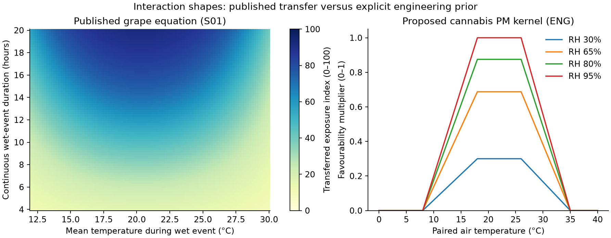
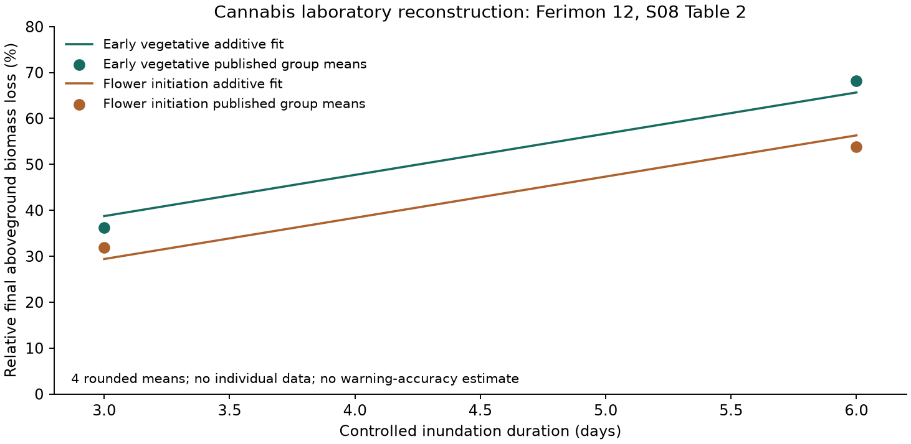

# WeedGrow - Weighted warning model

v6.0  |  RESEARCH SPECIFICATION AND EXECUTABLE PROTOTYPE  |  29 OCTOBER 2026

A concrete model for the 14 outdoor warning detectors, using published equations where transferable, a small cannabis-specific data fit where possible, and explicit operating weights for the remaining decisions.

Recommendation: implement this as a versioned research model and evaluate it in shadow mode. It produces exposure scores, eligibility and care states. It has not demonstrated improved field accuracy, and its scores are not disease probabilities.

## What this version adds

- Numerical weights and interaction formulas, with separate gates that points cannot override.
- Cannabis-specific powdery mildew, bud rot, temperature and waterlogging evidence, including 2025-2026 studies.
- Ranges for missing inputs and proposed-weight sensitivity; separate occurred and forecast evaluations.
- A reproducible cannabis waterlogging fit, complete reference code, machine-readable configuration, examples and 146 executed logic checks.

This is the warning-scoring successor to the warning sections of v5.2, not a replacement for its complete water-balance, permissions and record contracts. It preserves the low-burden product: routine watering logs; one-time setup; optional observations only when needed. It does not require daily moisture checks.

Deliverables: this linked PDF; matching editable Markdown; configuration and all 89 prior factor mappings; a standalone Python reference core; an example bundle; and a verification ledger. The app itself was not changed.

<!-- page break -->

# 01  The system to build

EXPOSURE MODEL + HARD GATES + CARE DECISION + DELIVERY POLICY

| Layer | Decision | Why it exists |
| --- | --- | --- |
| 1. Normalize | Which facts are valid, where, when and from which source? | Bad intervals cannot be fixed by sophisticated weights. |
| 2. Establish relevance | Does the plant have the tissue/setup required? | No flowers means no bud-rot weather card; unknown flowers means unassessed. |
| 3. Compute exposure | Combine paired weather and duration; propagate missingness. | Temperature and humidity must occur together, not as unrelated daily extremes. |
| 4. Add bounded context | Use local drying, tissue density, damage and history. | Context changes attention; cannot invent exposure or a pathogen. |
| 5. Reconcile care | Water reserve, excessive water, symptoms and severe events remain distinct. | Heat does not automatically mean water; normal moisture does not mean root rot. |
| 6. Deliver one useful card | Group causes, apply episode state and lead time. | Fourteen detector IDs do not mean fourteen notifications. |

## Output contract

```
warningId, family, state, scoreBand, scoreUnits, level
mode: occurred | forecast
validFrom, validTo, asOf, availableAt, locationEpoch
reasons, missingFields, sourceClass, rulesetVersion
action, relatedWarnings, episodeId, deliveryState
```

The reference core implements numerical evaluation and a delivery simulation on normalized scalar/interval inputs. The production wrapper must supply the timestamp/location/source envelope, resolve permissions, create episodes and persist delivery state. A synthetic example is not a provider integration.

Disease remains a separate inference: susceptible tissue AND a pathogen AND suitable conditions. Weather primarily estimates the third component. Even a strong exposure index may have no infection when inoculum is absent. [S13](https://horticulture.oregonstate.edu/nursery/nursery/disease-triangle)

<!-- page break -->

# 02  What the evidence can support

FOUR PARAMETER CLASSES; NO UNMARKED SCIENTIFIC WEIGHTS

| Class | Meaning | Examples in this model |
| --- | --- | --- |
| PUB | A published numerical value, kept with its original domain. | Broome berry and Nair-Allen flower curves; South African field Kc; TOMCAST lookup structure. |
| DER | A transparent calculation fitted to published outcome data. | Additive duration/stage response fitted to four cannabis waterlogging group means. |
| ENG | A concrete engineering starting value, informed by mechanism but not a measured effect size. | 80/20 exposure-context split, 65/35 heat split, kernels, thresholds, half-life, cooldown and sensitivity spans. |
| CAL | A parameter or decision needing local/cannabis target validation. | All ENG choices; transferred-model usefulness; provider and wetness errors; notification precision. |

The literature does not supply a coherent outdoor-cannabis warning coefficient set covering all 14 detectors. This version makes a useful starting set explicit instead of disguising qualitative evidence as measured weights. A published fan-treatment effect, genotype difference or photosynthesis reduction is not interchangeable with an outdoor warning coefficient.

## Cannabis findings that change the design

- PM does not require the old RH >=85% screen. The 80%-then-70% inoculation protocol is compatible with infection; another controlled study reports development at 65% RH. These are not full response curves. [S04](https://www.frontiersin.org/journals/plant-science/articles/10.3389/fpls.2025.1543229/full) [S06](https://www.tandfonline.com/doi/full/10.1080/07060661.2026.2649769)
- Bud rot can reflect earlier flower exposure and delayed symptoms. Store exposure history and retain scout context after the weather improves. [S05](https://www.tandfonline.com/doi/full/10.1080/07060661.2025.2478250)
- Genotype and phenology matter, but a marketing strain name is not a validated resistance measurement. [S04](https://www.frontiersin.org/journals/plant-science/articles/10.3389/fpls.2025.1543229/full) [S07](https://apsjournals.apsnet.org/doi/10.1094/PDIS-07-25-1591-RE)
- Waterlogging has measured cannabis duration and developmental-stage effects under a narrow experimental setup. Use that evidence as a laboratory comparator, not a safe waiting period. [S08](https://www.mdpi.com/2673-7655/6/5/90)

<!-- page break -->

# 03  Complete weighting ledger

WEATHER AND ROOT FAMILIES: ENG UNLESS SPECIFIED

| ID / detector | Numerical combination | Eligibility and role |
| --- | --- | --- |
| W01 Heat exposure | 65% peak intensity + 35% heat dose | valid air peak >=32 C OR applicable source alert |
| W02 Cold / frost / freeze | 70% minimum intensity + 30% cold dose | valid air minimum <=5 C OR applicable source alert |
| W03 Wind | 80% gust + 20% sustained wind | gust >=15 m/s OR sustained >=10 m/s OR applicable source alert |
| W04 Heavy rain | 50% rate + 50% complete rolling-24h amount | rate >=10 mm/h OR complete 24h >=25 mm OR applicable source alert |
| W05 Hail / severe weather | source event only; no synthetic numeric severity | explicit mapped hail/severe event |
| W06 Watering need | joint physical reserve ensemble; no additive points | supported reconciled reserve-minus-action-threshold margins |
| W07 Excess root water / poor aeration | 70% excess magnitude + 30% persistence | qualified abnormal pooling OR supported excess AND beyond normal drainage window |
| W08 Container heat context | inherit W01 once; no extra heat vote | pot AND ((heat AND exposed/hot-contact) OR supported root-temperature screen) |
| W09 Dampness / dew context | typed episode only; no extra disease points | supported paired night episode OR explicit fog |

The weights rank score contributions after eligibility. They are not fractions of real-world disease causation. Event screens and official-source routes survive an incomplete severity score. Do not suppress a genuine 16 m/s gust because the sustained-wind field is missing.

W05 and W09 deliberately have no fabricated severity percentage. W06 uses a physical water balance, not an arbitrary weighted sum of age, temperature and time since watering. W08 inherits its heat context once.

<!-- page break -->

# 04  Disease weights and combinations

SHARED 80/20 POLICY; TISSUE AND EXPOSURE GATES ARE MANDATORY

| ID | Primary exposure score A | Context score B; within-context weights |
| --- | --- | --- |
| W10 PM | 72-hour PM kernel exposure; next-24h forecast scored separately. | 50% crowding/poor local airflow + 30% local history + 20% verified susceptibility. |
| W11 Bud rot | Maximum of humid-air exposure and an eligible grape-curve wet-event envelope. | 40% dense flowers/slow local drying + 30% fresh damage + 30% local history. |
| W12 Wet leaf | 25 x TOMCAST DSV comparator, with wetness uncertainty. | 50% splash/debris exposure + 30% poor local drying + 20% local history. |
| W13 Establishment | Reuse W07, gated to vulnerable establishment. | No additional root-disease score or generic age multiplier. |
| W14 Root/wilt | Reuse W07 or independent reported-problem route. | No combined humidity + rain + wilt pathogen probability. |

```
Nominal S = 0.80 * A + 0.20 * B
Sensitivity: core weight w in {0.70, 0.80, 0.90}
S_low  = min(w*A_low  + (1-w)*B_low)
S_high = max(w*A_high + (1-w)*B_high)
Required: relevant tissue AND supported primary route
AND A_low >=25 AND S_low >=35 for a robust conditions card
```

Within-context inputs are 0-1: false/confirmed absence =0, qualified presence =1, a supported graded value may be intermediate, unknown =[0,1]. Do not default missing setup or history to false. The qualitative fact must have scope and effective time. A vague label such as "good airflow" must not be converted to a precise local wind speed.

At the nominal split, W11 density contributes at most 8 attention points, damage 6 and history 6. All three together contribute at most 20 and cannot create eligibility without primary exposure. A source symptom report takes an independent problem-review path; it is not added as another weather weight.

<!-- page break -->

# 05  Interactions, ranges and thresholds

A RANGE DESCRIBES MODEL ASSUMPTIONS, NOT STATISTICAL CONFIDENCE

| Rule | Concrete behavior |
| --- | --- |
| Joint conditions | Multiply temperature and humidity favourability within each paired interval; integrate the product over time. |
| Alternative pathways | For W11, use max(humid-air route, eligible wet-event route). Do not add both as independent evidence when they describe the same wet episode. This max policy is ENG. |
| Missing context | Keep [0,1] for that feature. Do not redistribute its weight to available factors. |
| Missing primary intervals | Known favourable exposure is the lower assumption; uncovered time may have been favourable in the upper assumption. Require >=80% valid time coverage (ENG), unless a complete independent route supports its own event. |
| Robust / conditional | Both core floor and score floor met at lower bounds: conditions_watch. Only upper bounds meet them: conditional_watch, with missing context explained. |
| Elevated / strong | Lower score >=65 / >=80 (ENG), with a qualifying core. These describe exposure, not infection likelihood. |
| Low result | not_triggered means the configured screen did not trigger. It never means disease-free or immune. |
| Structural uncertainty | The wet-event route spans two grape tissue models. Pathogen presence, canopy microclimate and kernel validity remain unknown even when a score range is narrow. |

Sensitivity spans are deliberately limited experiments: weights 70/80/90%, exposure scales +/-25%, estimated wet hours +/-3. They are not posterior intervals, guarantees or exhaustive model uncertainty. A model can be consistently wrong across all these choices.

Example: core A=70 and known context B=40 give nominal S=64 and sensitivity range 61-67. This supports an attention card but not a robust elevated-exposure push candidate. Reporting only 64 would hide this decision instability.

<!-- page break -->

# 06  Inputs, provenance and low user burden

USE AVAILABLE FACTS WHERE THEY CHANGE A VALID MODEL

| Input | How it changes the model | If unknown |
| --- | --- | --- |
| Watering log; optional volume | Adds an event to reserve accounting; retained input is not automatically applied volume. | Without volume, use a qualified event range; do not reset to full capacity. |
| Pot/ground and pot dimensions | Choose hydraulic domain; volume bounds physical storage. | Broad pot-size string is insufficient for precise litres. |
| Medium texture/composition; drainage | Sets supported storage and normal drainage profiles. | "Store" or "raised" is provenance/layout, not hydraulic texture. |
| Age, stage and rooting status | Choose tissue relevance, establishment and water-profile evolution. | A dated recorded stage outranks guessed age-based stage; clone age differs from seed age. |
| Height / canopy dimensions | Useful measured plant-size inputs for water demand and physical preparation. | Height alone is not leaf area, root depth or a wind-damage coefficient. |
| Rain reception: soil and canopy | Soil reception changes retained-rain accounting; canopy reception changes direct leaf-rain route. | Use separate yes/partial/no/unknown fields; unknown stays uncertain. |
| Local crowding, damage, history | Optional bounded disease context; observations can update it. | Weather route remains available with a wider context range. |
| Hourly paired T/RH/rain/wind | Exposure and wetness comparator; preserve interval and nature. | Daily extrema cannot reconstruct paired exposure. |
| Root/leaf observations or sensors | Optional independent support or symptom path. | No daily observation requirement; no invented normal finding. |

Setup should ask only facts the grower can answer: container/ground, approximate pot volume where known, medium option with uncertainty, current stage, sun/shelter and whether rain reaches soil and foliage. Do not force novice users to estimate leaf-area index or hydraulic conductivity. Use validated profile ranges or abstain on the affected numerical output.

<!-- page break -->

# 07  Weather time and exposure history

NO FUTURE RAIN CREDIT; NO FORECAST PROMOTION BY AGEING

```
Occurred lane: intervals in [-72h, 0], relative to asOf
Forecast lane: intervals in [0, +24h], separate result
Each interval: start, end, nature, valid, T, RH
Optional rain amount and independently supported leaf wetness
Reject overlaps, invalid order and mixed source natures
```

History must come from actual or retrospective weather products. A forecast cached yesterday is still a forecast today. A current rain rate is mm/hour, not a full-day total. A complete 24-hour rain amount cannot be formed by adding overlapping hourly and daily records. [S12](https://openweathermap.org/api/one-call-3)

## Exposure integration - ENG

```
f(T,RH) = temperature response * humidity response
Occurred recency r(t) = 2 ** (t / 48h), with t <=0
E = integral(r(t) * f(T(t),RH(t)) dt)
Forecast: r(t)=1 within the separate forecast window
A = 100 * (1 - exp(-E / E_star))
```

Half-life 48h; PM E_star=12 favourable equivalent hours; humid Botrytis E_star=8. Integrate the exponential exactly over each known interval in the reference. Uncovered time widens the upper scenario. These scales need field calibration; they are not measured infection incubation periods.

Operational history: retain W11 exposure episodes for 35 days (ENG retention choice) independently of the decaying score. This preserves delayed-scout context. It does not claim infection remains viable for 35 days, identify an infection date, or require daily inspecting. A dry day can reduce the current exposure score without declaring an earlier exposed flower healthy. [S05](https://www.tandfonline.com/doi/full/10.1080/07060661.2025.2478250)

<!-- page break -->

# 08  Response curves and shared causes

THE SHAPES MATTER MORE THAN A LONG ADDITIVE FACTOR LIST



Left: the published grape equation is nonlinear in temperature and wetness. Right: the proposed PM kernel is an explicit engineering approximation, not fitted cannabis dose-response data. The charts must not be presented as cannabis infection probability.

```
PM: trapezoid(T; 8,18,26,35) * H(RH)
H(RH)=clip(RH/50) * [0.5 + 0.5*ramp(RH;50,90)]
Humid Botrytis: trapezoid(T;5,15,25,35)
                  * ramp(RH;65,95)
trapezoid(a,b,c,d): 0 at/outside a,d; 1 from b to c
ramp(x;a,b)=clip((x-a)/(b-a),0,1)
```

Cannabis evidence rules out the old 85% necessary condition for PM; it does not establish these knots or saturation rates. Low ambient RH cannot exclude a humid leaf boundary layer, and suitable ambient weather may be common without disease. Both are prospective failure modes. [S04](https://www.frontiersin.org/journals/plant-science/articles/10.3389/fpls.2025.1543229/full) [S06](https://www.tandfonline.com/doi/full/10.1080/07060661.2026.2649769)

Independently supported free water widens the PM exposure range using a 0.5-1 multiplier (ENG hypothesis). Rain probability and high RH alone never supply that protective modifier. Rain/free-water effects are not a validated cannabis immunity rule; preserve this as sensitivity, not a downward point estimate. [S07](https://apsjournals.apsnet.org/doi/10.1094/PDIS-07-25-1591-RE)

<!-- page break -->

# 09  W01-W02: heat and cold

INTENSITY AND DURATION; AIR EXPOSURE IS NOT TISSUE INJURY

| Detector | Exact score and initial screen | Factor interpretation |
| --- | --- | --- |
| W01 Heat | I=ramp(Tpeak;30,40). D=1-exp(-DH30/24). S=100*(.65 I+.35 D). Air screen >=32 C. | DH30 integrates max(T-30,0) in degree-hours. Stronger/longer air heat increases attention. Solar/acclimation/stage route action; they have no fitted injury multiplier. |
| W02 Cold | I=ramp(5-Tmin;0,10). D=1-exp(-DH5/48). S=100*(.70 I+.30 D). Air screen <=5 C. | DH5 integrates max(5-T,0). Subtypes: <=0 air-freezing; else <=2 possible frost; else cold. Cloud/wind can alter surface cooling; calm is not necessary for cold injury. |

All score curves, dose scales and screens above are ENG. An applicable attributed official event is an independent route and has no synthetic severity score. A numerical event can be eligible with only a valid peak/minimum; its missing dose widens the score rather than cancelling the event.

Cannabis genotypes differ in photosynthetic temperature response. The cited chamber work does not validate a universal air threshold for injury; the 32 C point is a preparation screen. Do not use human feels-like temperature, infer leaf/root temperature, or translate a photosynthesis decrease into percentage tissue damage. [S03](https://pmc.ncbi.nlm.nih.gov/articles/PMC3550580/)

## Interactions and useful action

- W01 plus exposed pot context adds W08 details to the same heat card. It does not count heat twice.
- Heat plus supported low reserve can coexist with W06 water_now. Heat plus supported moist/excess reserve does not create extra watering.
- Fresh wilt is a reported problem with several possible causes. Avoid automatic water recommendations from wilt alone.
- Severe-source validity/expiry, quiet hours and lead time belong to delivery. An alert for people must retain its attribution rather than becoming a measured cannabis-injury event.

<!-- page break -->

# 10  W03-W05: destructive weather

SOURCE EVENTS AND PHYSICAL EXPOSURE HAVE DIFFERENT LOGIC

| ID | Score / threshold - ENG | Combination and limits |
| --- | --- | --- |
| W03 Wind | S=100*[.80*ramp(gust;10,25)+.20*ramp(mean;6,16)]. Initial screen gust >=15 or mean >=10 m/s. | OR eligibility; missing gust does not remove a valid sustained-wind event. Taller/unsupported or unstable pots change preparation; no arbitrary size-based injury probability. Regional wind is not canopy airflow protection. |
| W04 Rain | S=100*[.50*ramp(rate;2,20)+.50*ramp(total24;10,50)]. Initial screen rate >=10 mm/h OR complete24h >=25 mm. | Do not use PoP as intensity or retained water. Rain reception gates each plant's soil/canopy consequences. Rain warning remains a regional/site exposure even for a sheltered plant; tailor the advice. |
| W05 Hail/severe | No weighted synthetic score; explicit source event only. | Require an applicable mapped event/code, hazard subtype and valid interval. Generic thunderstorms, heavy rain or gusts alone cannot identify hail at the plant. |

Do not add a severe-weather alert, its rain, its gust and W05 as four independent severity votes. Group them into one weather-preparation card with separate cited hazards. A headline may prioritise destructive weather over a routine conditions card, but the water state must remain available.

Unknown local shelter or plant dimensions must not prevent a valid regional hazard from being shown. Conversely, an official feed that was never fetched is not evidence that no warning exists. Preserve source availability independently of numeric-weather support. [S12](https://openweathermap.org/api/one-call-3)

Reference adapter flags are separate: weatherSupport qualifies numeric intervals; hazardSupport qualifies mapped source products. A supported hail/heat product survives missing numeric weather. An unsupported hazard feed remains unassessed even if air temperature is valid.

<!-- page break -->

# 11  W06: watering without daily checks

USE A SUPPORTED PHYSICAL MODEL, NOT WEATHER POINTS

```
R_next = R_now + retainedIrrigation + retainedRain
         - plantUptake - mediumEvaporation - drainage
For each supported joint scenario j:
  margin_j = availableReserve_j - actionThreshold_j
all margins <0: water_now
all margins >0: not_due
otherwise: uncertain; explain which uncertainty matters
```

The routine interface should give water / not due where the whole supported scenario ensemble agrees. An unresolved state is essential when the model cannot distinguish them. Converting uncertainty into a false no-water answer would be a product defect. The reference implements this decision boundary, not the reserve-model producer. [S11](https://www.fao.org/4/X0490E/x0490e0e.htm)

| Factor | Required effect on the water model |
| --- | --- |
| Pot size and active roots | Physical volume bounds capacity; a seedling does not immediately access the full pot. |
| Medium and ground | Profile-specific retention/drainage and active rooting layers; no automatic clay/sand choice from soil provenance. |
| Age, stage and measured size | Domain/profile and demand evolution; no universal linear age multiplier or height-to-leaf-area equation. |
| Rain and irrigation | Count received, infiltrated, retained input with uncertainty; no automatic complete refill after a log/rain report. |
| Weather / ET | Paired demand inputs, ET method and quality; forecast changes future crossing, not current stored water. |
| Optional credible observation | Can initialize or reconcile state after setup/repot/conflict; not required every day. |

A 2025 South African field study reports Kc initial .70, development .75, mid-season .77, mature .66. These PUB values can seed a matching ground profile after local verification; they do not define pot litres, a universal plant dose or stage durations. Field ET also includes non-transpiration losses. [S02](https://pmc.ncbi.nlm.nih.gov/articles/PMC12398160/)

Alternatives where precise reserve is unsupported: a validated broad profile with a wider due-time interval; an optional pot-mass/sensor calibration; or a targeted one-off check when initialization/conflict prevents an answer. Avoid asking daily just to compensate for an unvalidated model.

<!-- page break -->

# 12  W07: excess water and poor aeration

OBSERVED ABNORMAL POOLING CAN TRIGGER ATTENTION IMMEDIATELY

```
eligible = qualifiedCurrentAbnormalPooling
           OR (supportedExcessAboveProfileBound
               AND beyondNormalDrainWindow)
S = 100 * (.70*excessMagnitude + .30*persistence)
qualified abnormal pooling: attention score floor 60 (ENG)
```

Magnitude and persistence are supported 0-1 profile features. Magnitude compares current excess against that profile's scale; persistence compares duration beyond its normal drainage window against a configured profile horizon. These normalizers must be versioned and measured for the setup. They are not supplied by a rain total alone.

Qualified abnormal pooling means relevant active-root/container drainage evidence, not a saucer that is dry, surface puddling remote from roots, or normal transient moisture during watering. A current report can prompt drainage attention before any full numerical profile exists. Missing severity inputs widen the score. Do not wait three days for the laboratory fit to become available.

## Factor combinations

- Heavy regional rain without soil reception or retention support is only an exposure, not proved saturation.
- A drainage model requires both excess and persistence; normal wet-to-draining behavior is not a disease warning.
- Fine/poorly drained medium can change the profile; "store soil" cannot select a fixed hydraulic coefficient.
- A young/recently rooted plant adds W13 establishment context to the same card. W14 may add a problem-review action; neither creates a new pathogen probability.
- Qualified current pooling conflicting with model water_now makes W06 uncertain until reconciled. Do not average the two into a confident instruction.

Root rot is a biological diagnosis requiring more than water status. This detector reports an environment that may harm aeration or a reported problem; it does not identify a causal organism.

<!-- page break -->

# 13  A fitted cannabis response from a study

DERIVED COEFFICIENTS, WITH A NARROW EXPERIMENTAL DOMAIN



```
L = 0.293956 + 0.089744*(durationDays - 3)
             + 0.093407*earlyVegetative
L: relative final aboveground biomass loss, not disease odds
Domain: 3-6 days; exact experimental protocol only
```

I fitted an additive model to S08 Table 2: control biomass 91 g; early vegetative 58/29 g after 3/6 days; flower initiation 62/42 g. Early treatment was at six true leaf pairs; the later treatment was flower initiation. The paper's biomass interaction was not significant, so this small reconstruction uses main effects rather than inventing an interaction coefficient. [S08](https://www.mdpi.com/2673-7655/6/5/90)

| Diagnostic | Result | What it means |
| --- | --- | --- |
| In-sample RMSE | 2.47 percentage points | Reconstruction of four rounded group means. |
| Leave-one-group-mean-out RMSE | 9.89 percentage points | A fragility check, not independent biological validation. |
| Data scope | 4 means; no individual data obtained | The study had five replicates/group; model fitting here cannot recover within-group error. |

This is a real source-derived stage/duration model, but only a comparator: Ferimon 12 under controlled inundation 2.5 cm above substrate. It is not added to W07 severity, used on ordinary moist soil, extrapolated to day 0-2, used to predict root rot, or used to delay current attention. A new cultivar/medium/oxygen regime requires new validation.

<!-- page break -->

# 14  W08-W09: useful context without double counting

CONTAINER HEAT AND DAMP LEAVES DO NOT MEASURE ROOT WATER

| Detector | Required combination | Effect / missing behavior |
| --- | --- | --- |
| W08 Container heat | Pot AND [(eligible heat AND qualified pot solar/hot-contact exposure) OR a supported root-temperature screen]. | Add pot-specific action to W01. Unknown pot exposure during heat is unassessed, not a protective false. A root sensor uses its supported profile, not an invented universal threshold. |
| W09 Dampness / dew | A supported paired nighttime episode OR explicit scoped fog observation/product. | Add drying/scout context to the relevant disease card. No separate disease points; no root-water credit; no claim of actual leaf wetness. |

## Required producer rules

Nighttime is derived from correct plant-location solar times. A dew/dampness proxy must use paired T/RH or quality-checked dew point at the same intervals and disclose its method, duration and coverage. If dew point exceeds air temperature beyond method tolerance, flag quality rather than applying abs(T-Td). A daily maximum RH and a separate daily minimum temperature cannot prove a night episode.

The v6 reference consumes a typed supportedNightEpisode rather than pretending to implement an unbenchmarked dew estimator. Select and benchmark that producer separately; its output must be called proxy dampness. A reported fog event can be an independent route. Neither route asserts the plant's flowers were wet.

Pot colour/material/solar exposure can change physical heating, but the current data do not establish a target-specific coefficient. Do not force a numerical weight for a field merely because the app stores it. Use it in relevance and action until a measured model supports quantitative use.

<!-- page break -->

# 15  W10: powdery mildew conditions

WEATHER EXPOSURE AND LOCAL SUSCEPTIBILITY; NEVER A DIAGNOSIS

```
Scope: known foliage present
A: paired PM kernel integrated over 72h (or next24h)
B=100*(.50*crowding + .30*localHistory
        + .20*verifiedSusceptibility)
Nominal S=.80*A+.20*B; sensitivity and gates as section05
Independent path: scoped reported powdery growth -> review
```

| Factor | Direction and combination | Evidence boundary |
| --- | --- | --- |
| Temperature + RH + time | Joint kernel; increasing favourable duration accumulates exposure. No rain requirement. | Cannabis-compatible settings at 65-80% RH rule out an 85% necessary gate, not a full fitted kernel. [S04](https://www.frontiersin.org/journals/plant-science/articles/10.3389/fpls.2025.1543229/full) [S06](https://www.tandfonline.com/doi/full/10.1080/07060661.2026.2649769) |
| Crowding / airflow | One combined local-context feature: +10 points maximum nominally. | Do not count crowding and its poor-drying consequence twice or substitute regional wind for canopy circulation. |
| Local history / susceptibility | At most +6 / +4 nominal points. Unknown widens the range. | History is not current inoculum confirmation. Genetic resistance must be verified and disease-specific. |
| Rain / wet surfaces | No automatic PM increase or immunity. Independently supported wetness explores a 0.5-1 core multiplier. | Magnitude is ENG. Weather-season associations are confounded; rain probability is not leaf washing. [S07](https://apsjournals.apsnet.org/doi/10.1094/PDIS-07-25-1591-RE) |
| Age and stage | Foliage gate and observation context; no age-day disease multiplier. | Do not turn delayed susceptibility or leaf loss into assumed acquired resistance. |

Important failure mode: the proposed kernel may classify many ordinary warm periods as conducive. A high score without pathogen evidence is a conditions message, not an infection alarm. Evaluate whether context improves predictive value and whether a sustained background card creates useful action or alert fatigue. The nominal kernel should be replaced if held-out evidence shows poor specificity.

The compatibility check uses the published 48-hour 80% RH initiation period followed by 70% RH. It does not claim initiation at 70% alone, prove this weighting is optimal, or measure missed infections in the field.

<!-- page break -->

# 16  W11: bud-rot conducive conditions

FLOWER TISSUE + A VALID EXPOSURE PATH + BOUNDED CONTEXT

```
A = max(humidAirExposure, wetEventPortfolio)
B=100*(.40*denseFlowersOrSlowDrying
        + .30*freshDamage + .30*localHistory)
Berry: I=-2.647866-.374927*W+.061601*W*T-.001511*W*T*T
       E_berry=100/(1+exp(-I))
Flower: Q=exp(-((T-23.7)/10.5)**2)
        E_flower=95.6*(1-exp(-(Q*W/1.3)**2))
Portfolio=[min(E_berry,E_flower),max(E_berry,E_flower)]
```

Both curves have PUB parameters; the envelope policy is ENG structural sensitivity, not a confidence interval. T is mean temperature during the same qualified wet event; W is its wet hours. Joint tested domain is 12-30 C and 4-20 hours. Outside it, leave this route unassessed. At 20 C/4h the curves give 16.3 versus 95.5 index points: tissue transfer matters. Neither is a cannabis probability. Original grape reset/extrapolation and spray rules are not ported. [S01](https://ipm.ucanr.edu/disease/database/grapebotrytis.html)

| Factor / interaction | Effect and eligibility |
| --- | --- |
| Flowers / phenology | Flowers are mandatory. A recorded flowering stage must map to actual tissue scope; unknown flowering does not become false. Keep age and flower-initiation date as context until a native response is fitted. |
| Wetness and temperature | Must describe the same continuous event. Sensor/reported/model wetness must have explicit quality, coverage and source nature. Rainfall hours alone are not flower wet hours. |
| Humid air versus wet event | Alternative routes. Complete independent wet event may support its own route even if the 72h ambient series is incomplete. Do not fake 72h coverage for an out-of-domain event. |
| Flower density / damage / history | Nominal maximum contributions 8 / 6 / 6 points. No modifier can create eligibility without core exposure. |
| Local flower microclimate | Keep uncertain; do not add a fixed greenhouse RH/T offset outdoors or convert a fan-treatment benefit into a station-wind protective multiplier. [S05](https://www.tandfonline.com/doi/full/10.1080/07060661.2025.2478250) |
| Past exposure / delayed symptoms | Retain episode history and separate reports from score decay. A later dry spell does not certify earlier exposed flowers healthy. [S05](https://www.tandfonline.com/doi/full/10.1080/07060661.2025.2478250) |

A 49-day experimental flowering cycle cannot define a universal day-of-flowering susceptibility curve for all outdoor cultivars. The prototype does not invent those stage weights from an abstract. A future native model can replace the transferred route when time-resolved outcome data are available.

<!-- page break -->

# 17  W12: wet-leaf disease conditions

A TRANSFERRED WETNESS COMPARATOR; NO SEPTORIA IDENTIFICATION

A supported leaf-wetness series is preferred. Until one is benchmarked, the reference includes a disclosed RH90/rain comparator: qualified direct leafWet wins; otherwise RH>=90% marks proxy wet time; assessed zero rain marks proxy dry time below that RH threshold; rain reaching the canopy supplies a direct-rain proxy route. Unknown reception, rain or paired temperature widens uncertainty. [S09](https://www.esalq.usp.br/departamentos/leb/agmfacil/artigos/artigos_sentelhas_2010/2010-A%26FMeteor_140%287-8%29_871-880_LWD-Portability.pdf)

| Mean wet T, rounded C | DSV 0 | DSV 1 | DSV 2 | DSV 3 | DSV 4 |
| --- | --- | --- | --- | --- | --- |
| 13-17 | 0-6 h | 7-15 h | 16-20 h | 21-24 h | - |
| 18-20 | 0-3 h | 4-8 h | 9-15 h | 16-22 h | 23-24 h |
| 21-25 | 0-2 h | 3-5 h | 6-12 h | 13-20 h | 21-24 h |
| 26-29 | 0-3 h | 4-8 h | 9-15 h | 16-22 h | 23-24 h |

This PUB lookup is the TOMCAST table structure. The reference uses whole mean temperature rounded half-up and completed wet hours rounded down (ENG bin convention). Outside the table temperature domain, the route is unassessed. It ports the lookup only: no claim of full original TOMCAST clock, dry-interruption/reset logic, spray thresholds or cannabis validation. [S10](https://bpb-us-e1.wpmucdn.com/blogs.cornell.edu/dist/1/8867/files/2019/08/draft-veg-tomato-diseases.pdf)

```
A = 25 * DSV  [score range if wetness uncertain]
B=100*(.50*splashOrDebris + .30*poorLocalDrying
        + .20*localHistory)
S=.80*A+.20*B; foliage and primary gates still apply
```

Estimated wet hours use +/-3-hour stress scenarios (ENG); they are not statistical intervals. The Kim paper shows portability errors can be material, but its reported MAE is not a valid conversion into this span. Implementing its full fuzzy model would be a separate port requiring coefficient/membership verification and a local benchmark. [S09](https://www.esalq.usp.br/departamentos/leb/agmfacil/artigos/artigos_sentelhas_2010/2010-A%26FMeteor_140%287-8%29_871-880_LWD-Portability.pdf)

Dampness, rain, dew, high RH and TOMCAST are not five independent votes. They are competing measurements/proxies for shared exposure. Leaf spots reported by the user take a problem-review route regardless of recent weather. Call this "wet-leaf disease conditions", not detected cannabis Septoria.

<!-- page break -->

# 18  W13-W14 and a coherent care card

ROOT CONDITIONS, VULNERABLE ESTABLISHMENT AND SYMPTOMS

| Detector | Gate and combination | User-facing meaning |
| --- | --- | --- |
| W13 Establishment | Vulnerable establishment AND W07 root concern; independent current establishment-problem report. | A young/recently rooted plant may be less resilient to the current root environment. This is not a diagnosis of damping-off. |
| W14 Root/wilt | W07 root concern OR qualified current root/wilt report. | Review the problem and root environment. Cause remains unconfirmed; heat, injury, drought and disease can overlap. |
| Shared root card | W07 primary; W13/W14 append relevant context and actions. | One root-care card. Do not count inherited scores three times. |

Establishment is a meaningful rooting state, not a fixed chronological cutoff. A newly rooted clone and a same-age seedling can differ. When establishment is unknown, generic supported root concern remains available while the specific W13 relevance is unassessed.

The reference treats current scoped symptoms independently from weather. A prior no_symptoms entry describes only the inspected tissue and time; it does not veto a later exposure. An absent observation is not a negative finding.

## Action hierarchy

- An explicit destructive weather event can lead the preparation card while retaining the independent water-state result.
- Current abnormal root conditions or a reported problem get a care surface immediately; do not wait for a disease-exposure push score.
- W01/W08 merge; W07/W13/W14 merge. W09 attaches to the relevant leaf/flower context.
- If symptoms suggest several possible causes, present the uncertainty and a targeted review step. Do not choose a diagnosis by whichever weather score is largest.

<!-- page break -->

# 19  Notifications and persistent state

THE PROTOTYPE SIMULATES DELIVERY; IT SENDS NOTHING

| Policy - ENG | Exact behavior / integration requirement |
| --- | --- |
| Conditions versus problem | Disease exposure can be a passive card. A reported problem gets review. Do not phrase "strong exposure" as "your plant is infected". |
| Push candidate | Explicit applicable source event OR robust elevated/strong disease exposure; not an estimated infection probability. Separate current root/water actions need their own care scheduling integration. |
| Deduplicate | Same episode does not repeat. W08/W13/W14 cannot create inherited duplicate pushes. |
| Cooldown | 48 hours between ordinary repeat candidates; exact severe-event escalation/expiry behavior requires production integration. |
| Hysteresis | Keep an existing exposure card until upper score <25; unknown assessment preserves stale prior state with current data status, never healthy clearance. |
| Initial historical load | Do not generate a new disease push simply because old weather was loaded. Current symptoms and valid source events retain their paths. |
| Flower history | Store occurred exposure episodes for 35 days. Forecast episodes never become occurred infection history. |
| Production flag | productionEnabled=false in all reference outputs and configuration. This is an executable design, not a live notification system. |

The persistent state needs episode IDs, source validity, first/last assessment, maximum exposure, last delivery, stale-data status and location/move epochs. A cooldown must not postpone a newly urgent water decision. Pure delivery simulation is not proof that app background execution, permissions, quiet hours, expiry and retries work.

Suggested wording: "Conditions have favoured powdery mildew; watch for white powdery patches" or "Recent damp flower conditions warrant checking for bud rot." Explain the leading factors and exposure dates. Do not display the 0-100 index as a disease percentage to a beginner.

<!-- page break -->

# 20  Worked calculations and counterfactuals

EXAMPLES COME FROM THE EXECUTABLE MODEL, NOT HAND-CHOSEN OUTPUTS

| Scenario | Reference output | Interpretation |
| --- | --- | --- |
| 72h at 23 C/92% RH; known foliage; demo PM context | W10 (81.5, 96.4); strong_exposure | Strong ambient exposure under these priors; still no proof of pathogen presence. |
| Same episode, known flowers; complete qualified 20 C/12h wet event | W11 (80.8, 93.9); strong_exposure | Humid and wet-event routes are alternatives; no double vote. |
| Leaf comparator DSV range 2-3; context unknown | W12 (35.0, 82.5); attention | Attention range is broad; no robust elevated push from this example. |
| Water reserve margins +0.4, +0.9 | W06 not_due | All supported scenarios above action threshold; no watering implied by disease exposure. |
| Core 70; context 40 | Nominal64; sensitivity61-67 | Attention, not robust elevated exposure. |
| All local disease modifiers present, core zero | not_triggered | Context cannot manufacture primary exposure. |
| Water margins negative but qualified root pooling now | uncertain; reconcile | Do not issue a contradictory water instruction. |

In this deliberately sustained-humidity example, the new PM kernel yields substantial exposure even below the old 85% threshold. That is the intended compatibility correction. It may also produce too many conditions cards; only outcome-linked field data can establish its value and determine better scales/thresholds.

See WeedGrow_Weighted_Warnings_v6.0_Example.json for the entire input and all 14 outputs. It includes simulated initial-load delivery suppression and finite JSON state. Editing context, weather or tissue fields permits reproducible counterfactuals.

<!-- page break -->

# 21  Verification and accuracy claims

MECHANICAL CORRECTNESS IS TESTED; PREDICTIVE PERFORMANCE IS NOT

| Executed work | Evidence / limit |
| --- | --- |
| Reference checks | 146/146 passing assertions: all warning IDs, gates, formula arithmetic, missingness, source nature, domains, interactions and simulated delivery. |
| Published model arithmetic | Broome and Nair-Allen reconstruction; tissue-model disagreement; temperature x wetness interaction; tested-domain refusal; TOMCAST bin monotonicity and field Kc constants. |
| Cannabis compatibility | 80%-then-70% PM assay protocol misses an RH>=85 necessary screen and remains eligible under the proposed exposure kernel. Not a comparison against labelled outdoor infections. |
| Cannabis fitted reconstruction | Four grouped waterlogging means; training and leave-one-group-out errors both reported. No individual-level fit or prospective validation. |
| Missingness / conflict | Unknowns cannot become safe zeros; context cannot replace core; unsupported water is not not_due; pooling conflicts with low-reserve inference. |
| No operational validation | Provider integration, reserve producer, live app behavior, push delivery and actual grower outcomes were not tested by these reference checks. |

No claim of 80%, 90% or improved cannabis warning accuracy is justified by this work. A source study's R-squared, treatment effect, grape classification score or fitted training error measures a different question. The grape mechanistic paper is useful architectural inspiration, but its apparent 17/21 and cross-validated 15/21 epidemic classifications are not WeedGrow accuracy. [S14](https://journals.plos.org/plosone/article?id=10.1371/journal.pone.0140444)

## Likely errors to investigate first

- PM specificity: sustained ordinary warm weather may trigger a conditions card without inoculum.
- Flower wetness and internal humidity: station air can underestimate the relevant microclimate.
- Rain spatial error and shelter: grid precipitation may not reach either soil or canopy.
- Ground reserve and unknown roots/medium: no unique moisture state follows from weather and nominal pot size alone.
- Outcome labels and intervention: alerted users inspect/treat more, which changes observed disease and creates selection bias.

<!-- page break -->

# 22  How the weights become trustworthy

A PROSPECTIVE COMPARISON, THEN A NATIVE FIT

| Stage | Required work and decision |
| --- | --- |
| A. Data foundation | Correct interval/unit/nature defects; archive forecasts as issued; retain raw hourly provenance and source gaps. Validate hydraulic profile producers before trusting W06/W07. |
| B. Shadow comparison | Freeze v5.2 threshold baseline and v6 parameters. Replay only information available at each asOf. Compare identical plants/time windows and warning outcomes. No later reanalysis leakage into historical forecast claims. |
| C. Independent outcomes | Opt-in research cohort supplies scheduled inspections in addition to alert-triggered checks; use scoped photos/expert adjudication or laboratory tests when needed. Regular end users still only need routine watering logs. |
| D. Quantify performance | Event sensitivity, positive predictive value, lead time, false cards/pushes per plant-week, abstention coverage and missed problems. Report by stage, pot/ground, medium, region, season and provider. |
| E. Fit native response | Use time-resolved native outcomes, not only a few season-level summaries. Fit penalized models or constrained response curves with interactions; keep tissue/domain gates outside fitted scores. |
| F. Validate and promote | Hold out plants/owners, time blocks and sites/seasons. Use plant-clustered uncertainty; tune thresholds on training/validation only. Publish the operating point and burden/sensitivity tradeoff. |

```
Candidate native endpoint model, after sufficient labels:
logit P(event within predefined horizon) = intercept
 + spline(joint T/RH exposure) + wetnessDuration
 + flowerStage + qualifiedLocalContext + interactions
 + site/season effects, with regularization
Then held-out calibration + decision-curve/alert-burden review
```

Select endpoint and horizon per disease before collecting labels. A root observation, PM lesion and destructive weather event are different endpoints. Do not treat a watering log, dismissal or no_symptoms at one moment as a definitive negative for all disease horizons. PM and bud rot need separate fits.

No universal sample size is defensible without event prevalence, clustering and desired precision. Run a pilot to estimate these, then calculate the cohort and seasonal coverage needed. A model can improve discrimination yet make a worse product if it creates too many low-value pushes.

<!-- page break -->

# 23  Integration work and release decision

A REVIEWABLE MODEL NOW; APP INTEGRATION AND FIELD CALIBRATION NEXT

| Area | Current gap / required implementation |
| --- | --- |
| Weather adapter | Previously identified cache issues: current rain rate stored as daily amount; future features attached to observed context; doubled UTC offset on solar times; daily[0] treated as observed without current. Fix with fixtures before weighting. |
| Weather storage | Retain paired raw intervals, nature, availability, source/method, coverage and location epoch; explicit hazard mapping. Existing mixed summaries cannot supply every v6 route. |
| Setup and observations | Add soil/canopy rain reception; preserve unknown/partial. Typed positive symptom/root reports and local context need a documented UI/storage path. Do not add daily logging requirements. |
| Reserve/root models | Implement and validate the supported profile/ensemble producers; profile normalization for root excess and persistence. The reference consumes these states and does not fabricate them from weather. |
| Warning/UI types | Existing watering/PM/rootRot suggestion kinds do not represent the full detector/state contract. Extend card grouping, uncertainty and source attribution. |
| Persistence and delivery | Implement episode lifecycle, history, stale assessment, deduplication, forecast expiry, permissions and move/repot resets. |
| Field performance | Shadow/pilot comparison, independent outcomes, failure review and approved operating thresholds before broad numeric-risk promotion. |

Repository observations are from the prior v5.x source review and are integration findings, not a claim that the deployed build was retested this turn. No app files or existing unrelated edits were changed for this addendum.

Adopt the architecture, explicit factor budgets, domain checks and machine-readable prototype. Treat the published coefficients as domain-limited, the small fitted cannabis response as exploratory, and all ENG weights as candidates to test. This is enough to implement a coherent warning engine; measured outdoor performance determines which numerical settings deserve release.

<!-- page break -->

# Evidence ledger: S01-S05

PRIMARY SOURCES; ACCESS SCOPE DISCLOSED

## [S01](https://ipm.ucanr.edu/disease/database/grapebotrytis.html) UC IPM: Broome (1995) and Nair-Allen (1993) Botrytis models

Published grape berry polynomial and grape flower response parameters. Their native tissues and tested domains differ. Both are transferred exposure comparators here. The source fit statistic is not WeedGrow accuracy; their model-disagreement envelope is not a confidence interval.

[Open primary source](https://ipm.ucanr.edu/disease/database/grapebotrytis.html)

## [S02](https://pmc.ncbi.nlm.nih.gov/articles/PMC12398160/) Denton et al. (2025): South African cannabis water use

Full text and PDF reviewed. Field evapotranspiration and stage Kc values support a matching ground-water profile. Field ET includes soil/background evaporation; it cannot be converted into a universal pot dose.

[Open primary source](https://pmc.ncbi.nlm.nih.gov/articles/PMC12398160/)

## [S03](https://pmc.ncbi.nlm.nih.gov/articles/PMC3550580/) Chandra et al. (2011): temperature response of cannabis genotypes

Seven genotypes had different photosynthetic temperature responses; optima spanned approximately 25-35 C. Gas-exchange response is not outdoor air-temperature injury probability. Supports cultivar uncertainty, not the proposed 32 C alert cutoff.

[Open primary source](https://pmc.ncbi.nlm.nih.gov/articles/PMC3550580/)

## [S04](https://www.frontiersin.org/journals/plant-science/articles/10.3389/fpls.2025.1543229/full) Seifi et al. (2025): cannabis powdery mildew resistance

Full methods reviewed: inoculated plants were held at 23 C/80% RH for 48 hours, then 70% RH during continued growth and later scoring. Infection in this protocol contradicts an 85% RH necessary-condition screen; it does not identify a minimum humidity or a complete field response curve.

[Open primary source](https://www.frontiersin.org/journals/plant-science/articles/10.3389/fpls.2025.1543229/full)

## [S05](https://www.tandfonline.com/doi/full/10.1080/07060661.2025.2478250) Buirs, Lung and Punja (2025): cannabis bud rot epidemiology

Publisher abstract and indexed methods reviewed; full PDF access unavailable. In a 49-day flowering cycle, inoculation timing affected disease, symptoms appeared later, and measured flower microclimate differed from ambient. Supports exposure history and local drying context; no universal outdoor flower correction or fitted WeedGrow weights.

[Open primary source](https://www.tandfonline.com/doi/full/10.1080/07060661.2025.2478250)

<!-- page break -->

# Evidence ledger: S06-S10

PRIMARY SOURCES; ACCESS SCOPE DISCLOSED

## [S06](https://www.tandfonline.com/doi/full/10.1080/07060661.2026.2649769) Punja (2026): HLVd and cannabis fungal susceptibility

Publisher abstract/indexed methods reviewed; full PDF access unavailable. Cannabis PM development was reported under 21-25 C and 65% RH, with genotype-dependent effects associated with HLVd status. Do not infer HLVd from weather, apply an unmeasured multiplier, or treat a strain label as a resistance assay.

[Open primary source](https://www.tandfonline.com/doi/full/10.1080/07060661.2026.2649769)

## [S07](https://apsjournals.apsnet.org/doi/10.1094/PDIS-07-25-1591-RE) Cannabis germplasm field resistance to G. ambrosiae (2026)

Publisher abstract and indexed discussion reviewed; full PDF access unavailable. New York field seasons show germplasm and phenology differences. Weather associations across two seasons do not identify independent weather coefficients. Supplementary and germplasm records are follow-up data sources, not downloaded training data in this work.

[Open primary source](https://apsjournals.apsnet.org/doi/10.1094/PDIS-07-25-1591-RE)

## [S08](https://www.mdpi.com/2673-7655/6/5/90) Kumar et al. (2026): short-term cannabis waterlogging, Crops 6(5):90

Peer-reviewed 25 September 2026 article, DOI 10.3390/crops6050090. Full public PDF reviewed; Tables 2 and 3 visually checked. Experiment 2 has five replicates/group, Ferimon 12, controlled inundation, early versus flower-initiation treatments and 3/6-day durations. This report fits four rounded group means; individual data were not obtained.

[Open primary source](https://www.mdpi.com/2673-7655/6/5/90)

## [S09](https://www.esalq.usp.br/departamentos/leb/agmfacil/artigos/artigos_sentelhas_2010/2010-A%26FMeteor_140%287-8%29_871-880_LWD-Portability.pdf) Kim et al. (2010): portability of leaf-wetness estimation

Primary full paper reviewed. Weather-based wetness estimation is feasible but site/sensor dependent. Fuzzy-model mean absolute errors at painted-sensor sites ranged 1.1-4.0 hours/day; these are neither a confidence interval nor an error estimate for WeedGrow. The paper's complete fuzzy model is not implemented here.

[Open primary source](https://www.esalq.usp.br/departamentos/leb/agmfacil/artigos/artigos_sentelhas_2010/2010-A%26FMeteor_140%287-8%29_871-880_LWD-Portability.pdf)

## [S10](https://bpb-us-e1.wpmucdn.com/blogs.cornell.edu/dist/1/8867/files/2019/08/draft-veg-tomato-diseases.pdf) Cornell NEWA: TOMCAST tomato disease model table

Primary extension model documentation, including temperature/wetness DSV lookup. This prototype ports only the lookup as a general wet-leaf exposure comparator. It does not implement the full TOMCAST day, interruption/reset rules, spray program or cannabis pathogen validation.

[Open primary source](https://bpb-us-e1.wpmucdn.com/blogs.cornell.edu/dist/1/8867/files/2019/08/draft-veg-tomato-diseases.pdf)

<!-- page break -->

# Evidence ledger: S11-S15

PRIMARY SOURCES; ACCESS SCOPE DISCLOSED

## [S11](https://www.fao.org/4/X0490E/x0490e0e.htm) FAO Irrigation and Drainage Paper 56: water balance

Physical basis for root-zone storage, depletion and ET accounting. Application requires supported parameters, units, rooting domain and retained water inputs. Not a justification for fixed watering days from age or pot volume alone.

[Open primary source](https://www.fao.org/4/X0490E/x0490e0e.htm)

## [S12](https://openweathermap.org/api/one-call-3) OpenWeather One Call 3.0 API documentation

Provider field definitions, including units, rain intervals and alert structures. Endpoint, entitlement and raw hourly storage must be verified for the actual deployment. A current rain rate, daily forecast amount and precipitation probability are different inputs.

[Open primary source](https://openweathermap.org/api/one-call-3)

## [S13](https://horticulture.oregonstate.edu/nursery/nursery/disease-triangle) Oregon State University: the disease triangle

Disease requires a susceptible host, pathogen and suitable environment. A weather model observes only part of this process; favourable conditions are not a diagnosis.

[Open primary source](https://horticulture.oregonstate.edu/nursery/nursery/disease-triangle)

## [S14](https://journals.plos.org/plosone/article?id=10.1371/journal.pone.0140444) Gonzalez-Dominguez et al. (2015): mechanistic grape Botrytis model

A useful architecture example coupling weather, host phenology and inoculum. Reported epidemic classification was 17/21 apparent and 15/21 cross-validated, not evidence of 81% cannabis accuracy. Its numerous grape parameters cannot be silently transferred.

[Open primary source](https://journals.plos.org/plosone/article?id=10.1371/journal.pone.0140444)

## [S15](https://ext.vt.edu/content/pubs_ext_vt_edu/en/SPES/spes-749.html) Virginia Tech: container plant/root system considerations

General container production context. Physical container volume and nominal substrate descriptions do not directly establish the young plant's active root-zone water reserve. General nursery guidance is contextual rather than cannabis-specific calibration.

[Open primary source](https://ext.vt.edu/content/pubs_ext_vt_edu/en/SPES/spes-749.html)

## Research boundary

Review cut-off: 29 October 2026. New sources were assessed alongside the user-supplied spec and prior v5.2 work. Full access was unavailable for S05-S07; their indexed primary excerpts support mechanism/design constraints only. Their unseen tables were not used to manufacture numerical coefficients. No videos or anecdotal cultivation claims were treated as coefficient evidence.
